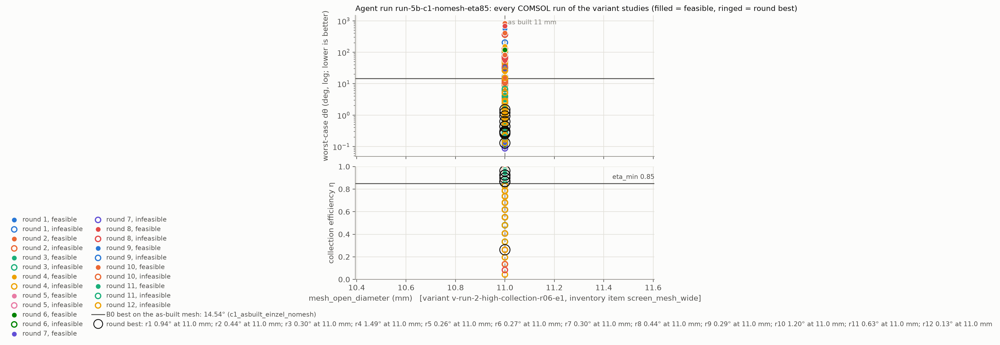

# Agent run `run-5b-c1-nomesh-eta85`: transcript

**Author's goal** (shown to the planner every round):

> Run 5b, chamber setup 1 (tube chamber alone) WITHOUT the screen mesh, very high collection: find the finest worst-case dtheta while collecting at least 85% of the emitted weight on the active MCP (eta_min 0.85; with no mesh the transmission is 1, so eta is the MCP fraction). Find out whether cfg 1 can reach this collection level, and at what resolution.
>
> Rules for this run: chamber setup 1 only: tube chamber alone, no deflectors. The MCP is the last part on the stack's tie rods and can sit anywhere from just behind the last present part to 130.7 mm behind the E1 front face, so removing plates lets the MCP come closer. Every configuration must use a model variant that removes the screen mesh (the validator enforces it); v-run-2-high-collection-r06-e1 is the approved one. The tip-E1 extraction voltage may be chosen between 120 and 300 V.
>
> The Baseline B0 table shows the optimizer alone on the as-built stack (E1-E9 all present, unused ones grounded) with the same budget. Your job is to beat it. Beyond voltages and positions you can change the structure: remove any of E2-E9, move plates, choose the wiring of the four LV channels, and propose inventory edits that keep the screen mesh out.
>
> You have many rounds: probe new structures with small studies and refine the promising ones.

Generated by `scripts/agent_run_report.py` from the run log and call folders. Paths are relative to this file; call folders are under `../calls/`.

## Overview

- method agent, case nominal, seed 0, models {"planner": "claude-opus-5-5", "critic": "claude-opus-5-5", "editor": "claude-opus-5-5"}
- started 2026-11-24T11:44:38+00:00, finished 2026-11-24T16:36:49+00:00, stop: budget
- solves 500; best 0.259 deg (job bdffd6d340d344c9bca0bea8b81f13c7)
- agent calls 24, 933 s, ~$3.905 (CLI estimate)
- assumptions: 2D axisymmetric model trusted for search; 3D used only to validate finalists once compute allows (plan_phase2 section 2; small known 2D/3D inconsistency, KNOWN_ISSUES #23); 3D promotion at finalize skipped: no 3D compute on this machine (author 2026-11-14); author goal given to the planner (steered run, not a blind evaluation): Run 5b, chamber setup 1 (tube chamber alone) WITHOUT the screen mesh, very high collection: find the finest worst-case dtheta while collecting at least 85% of the emitted weight on the active MCP (eta_min 0.85; with no mesh the transmission is 1, so eta is the MCP fraction). Find out whether cfg 1 can reach this collection level, and at what resolution.

Rules for this run: chamber setup 1 only: tube chamber alone, no deflectors. The MCP is the last part on the stack's tie rods and can sit anywhere from just behind the last present part to 130.7 mm behind the E1 front face, so removing plates lets the MCP come closer. Every configuration must use a model variant that removes the screen mesh (the validator enforces it); v-run-2-high-collection-r06-e1 is the approved one. The tip-E1 extraction voltage may be chosen between 120 and 300 V.

The Baseline B0 table shows the optimizer alone on the as-built stack (E1-E9 all present, unused ones grounded) with the same budget. Your job is to beat it. Beyond voltages and positions you can change the structure: remove any of E2-E9, move plates, choose the wiring of the four LV channels, and propose inventory edits that keep the screen mesh out.

You have many rounds: probe new structures with small studies and refine the promising ones.; config overrides (placeholders, not author decisions): @file:config/exp_c1_nomesh_eta85.yaml

| round | action | diagnosis | validation | study | solves | score | eta | feasible | critic | counted |
|---|---|---|---|---|---|---|---|---|---|---|
| 1 | optimize | none | ok | run-5b-c1-nomesh-eta85-r01 | 40 | 0.937 | 0.962 | 1 | dispute | 1 |
| 2 | optimize | parametric | ok | run-5b-c1-nomesh-eta85-r02 | 40 | 0.436 | 0.924 | 1 | accept | 1 |
| 3 | optimize | parametric | ok | run-5b-c1-nomesh-eta85-r03 | 50 | 0.304 | 0.867 | 1 | accept | 1 |
| 4 | optimize | parametric | ok | run-5b-c1-nomesh-eta85-r04 | 45 | 1.49 | 0.924 | 1 | dispute | 1 |
| 5 | optimize | parametric | ok | run-5b-c1-nomesh-eta85-r05 | 40 | 0.259 | 0.867 | 1 | accept | 1 |
| 6 | optimize | parametric | ok | run-5b-c1-nomesh-eta85-r06 | 50 | 0.273 | 0.867 | 1 | dispute | 1 |
| 7 | optimize | parametric | ok | run-5b-c1-nomesh-eta85-r07 | 40 | 0.298 | 0.867 | 1 | dispute | 1 |
| 8 | optimize | structural | ok | run-5b-c1-nomesh-eta85-r08 | 35 | 0.439 | 0.898 | 1 | dispute | 1 |
| 9 | optimize | parametric | ok | run-5b-c1-nomesh-eta85-r09 | 45 | 0.291 | 0.867 | 1 | dispute | 1 |
| 10 | optimize | structural | ok | run-5b-c1-nomesh-eta85-r10 | 30 | 1.2 | 0.867 | 1 | dispute | 1 |
| 11 | optimize | structural | ok | run-5b-c1-nomesh-eta85-r11 | 45 | 0.625 | 0.924 | 1 | dispute | 1 |
| 12 | optimize | parametric | ok | run-5b-c1-nomesh-eta85-r12 | 40 | 0.13 | 0.262 | 0 | dispute | 1 |

| call | role | model | retries | s | $ | error |
|---|---|---|---|---|---|---|
| run-5b-c1-nomesh-eta85/r01_planner_0 | planner | claude-opus-5-5 | 0 | 19 | 0.1056 |  |
| run-5b-c1-nomesh-eta85/r01_critic_0 | critic | claude-opus-5-5 | 0 | 52 | 0.1961 |  |
| run-5b-c1-nomesh-eta85/r02_planner_0 | planner | claude-opus-5-5 | 0 | 25 | 0.1121 |  |
| run-5b-c1-nomesh-eta85/r02_critic_0 | critic | claude-opus-5-5 | 0 | 52 | 0.2155 |  |
| run-5b-c1-nomesh-eta85/r03_planner_0 | planner | claude-opus-5-5 | 0 | 21 | 0.1128 |  |
| run-5b-c1-nomesh-eta85/r03_critic_0 | critic | claude-opus-5-5 | 0 | 62 | 0.2280 |  |
| run-5b-c1-nomesh-eta85/r04_planner_0 | planner | claude-opus-5-5 | 0 | 22 | 0.1118 |  |
| run-5b-c1-nomesh-eta85/r04_critic_0 | critic | claude-opus-5-5 | 0 | 53 | 0.2091 |  |
| run-5b-c1-nomesh-eta85/r05_planner_0 | planner | claude-opus-5-5 | 0 | 28 | 0.1260 |  |
| run-5b-c1-nomesh-eta85/r05_critic_0 | critic | claude-opus-5-5 | 0 | 66 | 0.2467 |  |
| run-5b-c1-nomesh-eta85/r06_planner_0 | planner | claude-opus-5-5 | 0 | 18 | 0.1079 |  |
| run-5b-c1-nomesh-eta85/r06_critic_0 | critic | claude-opus-5-5 | 0 | 39 | 0.1787 |  |
| run-5b-c1-nomesh-eta85/r07_planner_0 | planner | claude-opus-5-5 | 0 | 35 | 0.1419 |  |
| run-5b-c1-nomesh-eta85/r07_critic_0 | critic | claude-opus-5-5 | 0 | 36 | 0.1799 |  |
| run-5b-c1-nomesh-eta85/r08_planner_0 | planner | claude-opus-5-5 | 0 | 33 | 0.1377 |  |
| run-5b-c1-nomesh-eta85/r08_critic_0 | critic | claude-opus-5-5 | 0 | 43 | 0.1874 |  |
| run-5b-c1-nomesh-eta85/r09_planner_0 | planner | claude-opus-5-5 | 0 | 35 | 0.1452 |  |
| run-5b-c1-nomesh-eta85/r09_critic_0 | critic | claude-opus-5-5 | 0 | 48 | 0.1806 |  |
| run-5b-c1-nomesh-eta85/r10_planner_0 | planner | claude-opus-5-5 | 0 | 31 | 0.1324 |  |
| run-5b-c1-nomesh-eta85/r10_critic_0 | critic | claude-opus-5-5 | 0 | 62 | 0.2345 |  |
| run-5b-c1-nomesh-eta85/r11_planner_0 | planner | claude-opus-5-5 | 0 | 32 | 0.1441 |  |
| run-5b-c1-nomesh-eta85/r11_critic_0 | critic | claude-opus-5-5 | 0 | 52 | 0.1842 |  |
| run-5b-c1-nomesh-eta85/r12_planner_0 | planner | claude-opus-5-5 | 0 | 24 | 0.1329 |  |
| run-5b-c1-nomesh-eta85/r12_critic_0 | critic | claude-opus-5-5 | 0 | 45 | 0.1540 |  |



Reference: best B0 baseline under the current spec, 14.540° (c1_asbuilt_einzel_nomesh, job `2b559c41d11a41909cbefca4e19fd317`), [summary plot](../../../2b559c41d11a41909cbefca4e19fd317/plots/summary.png).

## Round 1

### Planner (`r01_planner_0`, 19 s, $0.106, 2026-11-24T11:44:57+00:00)

**Input** (the full prompt the planner received; role instructions in `r01_planner_0/system.md`):

```markdown
# Author's goal for this run
Run 5b, chamber setup 1 (tube chamber alone) WITHOUT the screen mesh, very high collection: find the finest worst-case dtheta while collecting at least 85% of the emitted weight on the active MCP (eta_min 0.85; with no mesh the transmission is 1, so eta is the MCP fraction). Find out whether cfg 1 can reach this collection level, and at what resolution.

Rules for this run: chamber setup 1 only: tube chamber alone, no deflectors. The MCP is the last part on the stack's tie rods and can sit anywhere from just behind the last present part to 130.7 mm behind the E1 front face, so removing plates lets the MCP come closer. Every configuration must use a model variant that removes the screen mesh (the validator enforces it); v-run-2-high-collection-r06-e1 is the approved one. The tip-E1 extraction voltage may be chosen between 120 and 300 V.

The Baseline B0 table shows the optimizer alone on the as-built stack (E1-E9 all present, unused ones grounded) with the same budget. Your job is to beat it. Beyond voltages and positions you can change the structure: remove any of E2-E9, move plates, choose the wiring of the four LV channels, and propose inventory edits that keep the screen mesh out.

You have many rounds: probe new structures with small studies and refine the promising ones.
(A direction to explore, not a new requirement: the specification still decides what counts as better. Report honestly if the results argue against it, and stop pursuing it when they do.)

# Specification
- ions: mass 22.99 Da, charge +1, E0 2.0 eV, energy spread 0.0 eV, emission HWHM 20.0 deg at the meniscus, pre-acceleration on
- emission angles: theta in every metric, r(theta) and weight is the angle at the meniscus. The emitter field bends the 2 eV ions toward the axis before the model launch point, so launch angles are several times smaller. Weights are Gaussian(HWHM 20 deg) x sin(theta): about half of the emission lies above the HWHM. Because a narrower accepted cone gives a larger dr/dtheta on the fixed MCP, the best designs tend to clip angles until eta just meets eta_min (0.85 with mesh transmission 0.7).
- goal: minimize the worst angular resolution dtheta (deg) over the evaluated emission angles, so the MCP spot maps emission angle to radius as finely as possible
- feasible requires: collection efficiency eta >= 0.85 (MCP active area x mesh transmission 0.7), monotonic r(theta), fast fraction >= 0.9 (impact speed of a 22.99 Da ion >= 1.6e+05 m/s, i.e. >= 3.05 keV per charge gained between the tip and the MCP front)
- detector: MCP diameter 40.0 mm, resolution sigma 70.0 um

# Design space
Chamber setups (positions in mm from the tip apex; [a, a] = fixed):
- cfg 1 (chamber 1 alone (tube)): z_mcp [10.0, 183.704], mesh_gap [12.7, 52.7], lens_gap [10.0, 53.0]
  The MCP is the last part on the stack's tie rods: its face sits behind the last present part (and behind the screen mesh, which it carries at mesh_gap) and at most 130.698 mm behind the e1 front face (rod end minus 10 mm). The optimizer keeps every sample inside these limits, so z_mcp's usable range depends on the configuration: removing plates (or the screen mesh) lets the MCP come closer to the tip. The deflectors do not exist in this setup.
- cfg 2 (chamber 2 alone (sphere)): NOT USABLE (position ranges not set)
- cfg 3 (chambers 1 and 2 joined): NOT USABLE (position ranges not set)
Supplies: 4 low-voltage channels ['LV1', 'LV2', 'LV3', 'LV4'], range [-300.0, 300.0] V. Each of ['tip', 'e1', 'e2', 'e3', 'e4', 'e5', 'e6', 'e7', 'e8', 'e9'] is wired to one channel or GND; electrodes on one channel share its voltage. HV ports have fixed roles {'HV1': 'mcp_front', 'HV2': 'mcp_back', 'HV3': 'phosphor', 'HV4': 'mesh'}; MCP front [-10000.0, -2000.0] V, mesh [-10000.0, 0.0] V.
Lens stack: 9 plates (e1 = extractor, aperture radius 5.0 mm), placed by lens_gap (tip apex to the e1 front face); as built, front faces from e1: e1 front 0.0 mm, e2 front 11.23 mm, e3 front 22.46 mm, e4 front 33.69 mm, e5 front 44.92 mm, e6 front 57.15 mm, e7 front 69.38 mm, e8 front 81.61 mm, e9 front 93.84 mm. Deflector pairs (grounded): d1 front 110.705 mm (cfg [3]), d2 front 124.165 mm (cfg [3]).
Part switches: configuration.removed may leave out ['e2', 'e3', 'e4', 'e5', 'e6', 'e7', 'e8', 'e9', 'd1', 'd2']; configuration.moved lets the optimizer tune the axial position of ['e2', 'e3', 'e4', 'e5', 'e6', 'e7', 'e8', 'e9'] (variable <plate>_offset_mm, front face from the e1 front face), keeping at least 2.23 mm between facing surfaces of neighbours and ending before 140.698 mm. As built, every plate already sits at that minimum gap, so a plate can only move into room made by removing a neighbour (or, without deflectors, the last plate can move back toward the mesh). The last part keeps the same minimum gap to the screen mesh's cross hub, or to the MCP and its surround when the variant has no screen mesh.
Optimizer rules (always enforced): no ion mirrors: every lens channel and the mesh stay below the tip potential (positive ions) and the tip stays above ground; extraction: the tip-e1 field accelerates the ions by >= 120 V and <= 300 V (author's window for V_tip - V_e1; the optimizer samples e1 inside it below the tip).
Optimizer variables (the names bounds use): each LV channel used by the wiring (V), HV1 (MCP front, V), HV4 (mesh, V), lens_gap_mm, mesh_gap_mm, z_mcp_mm and <plate>_offset_mm of moved plates (mm). A position fixed by its range ([a, a]) is not a variable. Omitted variables keep their full usable range.
Model variants (configuration.variant_id; 2D models the editor built and the author approved):
- base: the as-built model
- v-demo-1-r01-e0: from base with ['screen_mesh_wide']; variables mesh_open_diameter_mm [10, 40] (as built 11); mesh transmission 0.7. Made the screen mesh's open diameter a parameter so the optimizer can try screen_mesh_wide. Added one global parameter, d_mesh_open = "11[mm]", the as-built value. The transparent mesh line (tag meshline) now runs from r = 0 to d_mesh_open/2 instead of to a fixed 5.5 mm. The cross hub rectangle (tag hub) now starts at r = d_mesh_open/2 instead of 5.5, so it moves out with the mesh edge. Its outer radius is now max(R_cross, d_mesh_open/2 + 2.985 mm) instead of max(R_cross, 8.485 mm). That keeps the 2.985 mm hub ring width from the as-built model (5.5 to 8.485 mm). The effective cross-ring edge stays at R_cross unless the moved hub reaches past it. At 11 mm both expressions give exactly the old values (meshline r 0..5.5, hub r 5.5..24.5), so the default build matches the parent. Nothing else changed: the hub sits at the same axial position (mesh_gap, hub 0.1 mm past the mesh plane), both parts still use V_screen (HV4), and all tags, labels, selections (geom1_meshline_bnd, geom1_hub_bnd), boundary conditions and mesh size settings are as before.
- v-run-2-high-collection-r06-e1: from v-demo-1-r01-e0 with ['no_screen_mesh', 'screen_mesh_wide']; variables mesh_open_diameter_mm INACTIVE (its part was removed; held at 11, not a variable); removed: ['screen_mesh']; mesh transmission 1. I removed the screen mesh and its cross hub from build_axisym.py (inventory removal no_screen_mesh, which replaces screen_mesh). In build_geometry, the hub Rectangle (tag hub, the -1 kV cross hub / effective cross ring from r = d_mesh_open/2 to R_cross) and the open meshline Polygon (tag meshline, the transparent mesh line at mcp_z - mesh_gap) are deleted. Both are also gone from the selresultshow loop. In build_physics, I deleted their two V_screen boundary conditions, pot_hub (on geom1_hub_bnd) and pot_mesh (on geom1_meshline_bnd). In build_mesh, I deleted their size features, s_mesh (0.2 mm) and s_hub (0.3 mm). Nothing now sits between the lens stack and the MCP front, so the MCP-front field reaches into chamber 2. Everything else is the same as in v-demo-1-r01-e0: chambers, needle, L1..L9, D1/D2, the MCP plate, surround, holder ring, all other boundary conditions, mesh settings and studies. The parameters V_screen, mesh_gap, d_mesh_open and R_cross are still in PARAMS, so every existing parameter name is kept, but no geometry or physics uses them now. There are no new parameters, switches or parts.
Author rule for this run (enforced by the validator): every configuration runs WITHOUT the screen mesh (and its cross hub). Use only model variants whose removed parts include ['screen_mesh']; an edit must start from such a variant.

# Baseline B0 (fixed hand-made configurations, same optimizer)
| study | configuration | valid runs | feasible runs | best feasible score (deg) | its eta |
|---|---|---|---|---|---|
| b0-c1_asbuilt_einzel_nomesh-2d-run5b | cfg 1 [e1:LV2,e2:LV4,e3:LV3,e4:LV4,tip:LV1] variant v-run-2-high-collection-r06-e1 | 500 | 280 | 14.5 | 0.924 |

Settings of each study's best run, value [usable range] (V, mm):
- c1_asbuilt_einzel_nomesh (best feasible run 2b559c41): LV1 189.9 [0, 300], LV2 7.048 [-300, 300], LV3 -166.1 [-300, 300], LV4 -291.9 [-300, 300], HV1 -7302 [-1e+04, -2000], lens_gap_mm 28.16 [10, 53], z_mcp_mm 141 [121.1, 183.7]

# Inventory (hypothetical parts we could order; action edit_then_optimize builds them into a 2D model variant, the author approves it)
- screen_mesh_wide (mesh, replaces screen_mesh; sweepable open_diameter_mm [10, 40] (as built 11); transmission 0.7): Screen mesh in front of the MCP with a larger open diameter: the transparent mesh disc grows, the screen cross hub moves out with its edge. Same potential (HV4) and mesh_gap as now.
- no_screen_mesh (removal, replaces screen_mesh; transmission 1): Run without the screen mesh and its cross hub: nothing between the lens stack and the MCP front, whose field then reaches into the chamber.

# Rounds so far
(no rounds yet)

# Best so far
(no valid, feasible result accepted yet)

# Budget
- solves used 0 of 500 (500 left); round 1 of 50
- solve_budget for this round: 10 to 60
- each bound must span at least 10% of the variable's usable range
- the loop stops after 12 rounds without improving the best score by more than 0.002 deg
```

**Decision:** `optimize`, diagnosis `none`

*Evidence:*

> First round. Baseline B0 (as-built E1-E9, einzel e2/e4 on LV4, e3 on LV3, no mesh) reached dtheta 14.5 deg at eta 0.924. That is well above eta_min 0.85, so the image can still be magnified further (clipping the cone down to eta ≈ 0.85). In B0, e5-e9 are grounded and only limit where the MCP can sit (z_mcp ≥ 121 mm).

- configuration: cfg 1; wiring [e1:LV2, e2:LV4, e3:LV3, e4:LV4, tip:LV1]; variant v-run-2-high-collection-r06-e1; removed ['e5', 'e6', 'e7', 'e8', 'e9']
- bounds: (none: full usable ranges)
- solve budget: 40

*Claims for the critic to check:*

1. **c1**: The best feasible run has eta between 0.85 and 0.92, i.e. it clips the cone closer to eta_min than B0 (0.924). *(evidence: eta of best feasible run)*
2. **c2**: Best feasible dtheta is below 14.5 deg (beats B0). *(evidence: best feasible score vs B0 14.5 deg)*
3. **c3**: r(theta) is monotonic over the full accepted angle range and the fast fraction is >= 0.9 in the best run. *(evidence: r(theta) plot and fast-fraction metric)*
4. **c4**: The best run places the MCP farther than 60 mm behind the e1 front face (it does not use the shortest drift). *(evidence: z_mcp_mm minus lens_gap_mm of best run)*

*Rationale:*

> Probe a structural change at low cost. Keep the B0 einzel wiring (tip LV1, e1 LV2, e2+e4 LV4, e3 LV3) but remove the unused grounded plates e5-e9. That opens the MCP range from about 45 mm behind e1 to 130.7 mm behind it. The optimizer can then choose between a short drift with a strong MCP field and a long drift. Without the grounded tube, the -kV MCP field also reaches further into the stack, which could act as an extra lens. Full ranges are kept because this is the first look at this structure. Next round's comparison: if it beats 14.5 deg, refine it with bounds. If not, the grounded tube helps, and the next probe keeps e5-e9 and changes the wiring or moves plates instead.

### Critic (`r01_critic_0`, 52 s, $0.196, 2026-11-24T12:08:12+00:00)

**Study `run-5b-c1-nomesh-eta85-r01`:** 40 solves on backend comsol; best job `548a3a93d3e44ff5995ef790f8ab398d`: score 0.937°, eta 0.962, feasible.


Plots the critic could open: `results/548a3a93d3e44ff5995ef790f8ab398d/plots/` (trajectories, field map, r(θ), dθ(θ), fates, axis potential, landing, summary).

**Verdict: DISPUTE**

> The run looks physically valid, and the checker's feasible verdict should stand. I'm disputing it because claim c1 is contradicted.
>
> Consistency checks:
> - **Voltages match the plots.** The labels show tip +267.5, E1 +105, E2 −111, E3 +208, E4 −111 and HV1 −9528, matching the wiring tip:LV1, e1:LV2, e2:LV4, e3:LV3, e4:LV4. The field map shows the same pattern: red at E1, blue at E2, red at E3, blue at E4, then a deep-blue MCP region.
> - **Energies add up.** The tip at +267.5 V plus the MCP at −9528 V plus the 2 eV start energy gives about 9797.5 eV, which matches the reported impact KE of 9797 eV. The model tip potential of +156.3 V equals 267.5 V minus the 111.1 eV pre-acceleration.
> - **No ion passes through metal.** Trajectories stay inside the bores. The widest blue rays reach r ≈ 4.8 mm at z ≈ 34 mm, inside the E3 bore. The red lost rays (θ > 40°) end on the bore walls, which matches electrode losses of 3.8% and mcp_active 0.96.
> - **No ions are left in flight.** The landed fraction is 1 for 0–40° and 0 above that. eta = 0.962 with no mesh is consistent with the fate fractions.
> - **Resolution is consistent with the detector.** The worst dθ of 0.937° is at θ = 0, where dr/dθ is about 0.08 mm/deg (0.162 mm over 2°). With σ = 70 µm, 0.07 / 0.075 ≈ 0.93°, as expected.
>
> Beam behaviour: the E2–E3 lens strongly focuses the beam to a crossover inside the stack, at z ≈ 41–47 mm. All rays cross the axis but keep their order, so r(θ) stays monotonic. On axis the potential peaks near +200 V at E3, while the total energy is about 269 V, so ions slow to roughly 60–70 eV there but still pass. Without a mesh, the −9.5 kV MCP field reaches up to the E4 exit. After the crossover it bends the diverging rays back toward parallel between z ≈ 60 and 80 mm. As a result the image is small: r_max is 5.84 mm on a 20 mm-radius MCP (fill fraction 0.20). r(θ) is strongly concave-up, from about 0.08 mm/deg near the axis to about 0.28 mm/deg at 40°, so the near-axis angles set the score.

| claim | status | evidence |
|---|---|---|
| c1 | contradicted | eta = 0.962, above the claimed range of 0.85–0.92 and also above B0 (0.924). The run clips less than B0, not more: only θ > 40° is lost (3.8% on electrodes). |
| c2 | supported | Best feasible score is 0.937°, far below B0's 14.5°. The run is feasible: eta 0.962 ≥ 0.85, fast fraction 1.0, r(θ) monotonic. |
| c3 | supported | The checker reports r(θ) as monotonic, and r rises strictly from 0.0126 mm at 0° to 5.84 mm at 40° over all 21 evaluated angles, with no fold in the r_theta plot. Fast fraction is 1.0 (≥ 0.9), and impact KE is about 9.8 keV. |
| c4 | supported | z_mcp = 105.0 mm and lens_gap = 10.4 mm, so the MCP sits 94.6 mm behind the E1 front face, more than 60 mm. The trajectory plot shows E1 starting at z ≈ 10.4 mm. |

*Failure modes observed:*

- A strong crossover inside the lens stack (z ≈ 41–47 mm, at the E3/E4 gap): every ray crosses the axis. r(θ) stays monotonic, but the rays are strongly bent, so r(θ) is very nonlinear (concave-up). Near the axis dr/dθ is only about 0.08 mm/deg, compared with about 0.28 mm/deg at 40°, so the worst dθ (0.937°) is at θ = 0.
- The MCP is under-filled: r_max is 5.84 mm on a 20 mm-radius detector, fill fraction 0.20, r90 4.04 mm. Most of the available magnification is unused.
- The MCP field reaches into the chamber (no mesh). The −9.5 kV field bends the diverging post-crossover rays toward parallel between z ≈ 60 and 80 mm, which shrinks the image.
- The beam nearly fills the E3 bore: rays reach r ≈ 4.8 mm against a bore radius of about 5 mm. Rays above 40° are clipped on the E3/E4 bore walls (3.8% electrode loss).
- Ions slow down at E3: the axis potential peaks near +200 V while the total energy is about 269 V, leaving roughly 60–70 eV kinetic. This makes the mapping sensitive to the LV3 setting.
- The cone is not clipped toward eta_min: eta is 0.962 against a target of 0.85, so about 11% of the efficiency margin is unused.

*Suggestions (non-binding):*

- The score is limited by the near-axis slope, so aim for higher paraxial magnification rather than tighter edge clipping. The image could grow about 3× before reaching the 20 mm MCP edge.
- Try a longer drift: z_mcp is at 105 mm, and the plot domain extends to about 190 mm. Also try a weaker post-crossover lens, for example a less negative E4, so the rays keep diverging toward the MCP.
- Try weakening the E2/E3 focusing (lower LV3 or a less negative E2), so the crossover moves or disappears and r(θ) becomes more linear. This would raise dr/dθ at small θ.
- With the Rayleigh-like weighting (σ ≈ 17°), eta = 0.85 corresponds to accepting up to about 33°. Clipping there would let the design spread 0–33° over most of the MCP radius.
- Watch the E3 bore: with r ≈ 4.8 mm already reached inside E3, stronger magnification inside the stack will increase electrode losses. Put the magnification in the drift instead.

## Round 2

### Planner (`r02_planner_0`, 25 s, $0.112, 2026-11-24T12:08:36+00:00)

**Decision:** `optimize`, diagnosis `parametric`

*Evidence:*

> The round-1 result is feasible: eta 0.962, fast fraction 1.0, r(theta) monotonic. The worst dtheta (0.937 deg) sits at theta = 0, where dr/dtheta is only about 0.08 mm/deg. The critic found the MCP badly under-filled: r_max 5.84 mm of 20 mm, fill fraction 0.20. A strong crossover at z of about 41-47 mm and the field of the -9.5 kV MCP pull the post-crossover rays back toward parallel, which shrinks the image. z_mcp was only 105 mm, against a usable maximum of 183.7 mm. The eta margin is also unused (0.962 vs 0.85). The structure works. The limit is magnification, and voltages, z_mcp and lens_gap inside this structure can still change it. The 40-solve study was shallow for 7 variables.

- configuration: cfg 1; wiring [e1:LV2, e2:LV4, e3:LV3, e4:LV4, tip:LV1]; variant v-run-2-high-collection-r06-e1; removed ['e5', 'e6', 'e7', 'e8', 'e9']
- bounds: z_mcp_mm [100, 183.7]
- solve budget: 40

*Claims for the critic to check:*

1. **c1**: The best feasible worst dtheta is below 0.80 deg, improving on round 1's 0.937 deg. *(evidence: checker score (worst dtheta) and feasible flag)*
2. **c2**: The best run places the MCP farther from the tip than round 1 (z_mcp > 115 mm) and fills more of the detector (r_max > 7 mm). *(evidence: z_mcp_mm in the best run's settings; spot r_max_mm / fill_fraction)*
3. **c3**: eta stays feasible but is lower than round 1 (0.85 <= eta < 0.96), since wider magnification clips more of the outer cone. *(evidence: eta / mcp_active fraction and ion fates (electrode, mcp_outside))*
4. **c4**: The worst dtheta still occurs at small emission angles (theta <= 6 deg), set by the near-axis slope dr/dtheta. *(evidence: dtheta(theta) curve / r_theta plot slope near axis)*

*Rationale:*

> Round 1's structure (e1-e4 present, e5-e9 removed, so the MCP can come closer) beat B0 by more than 15x. The critic shows the score is limited by paraxial magnification, not by a structural flaw: the image covers about 20% of the MCP and r(theta) is strongly concave-up because of an internal crossover, with the MCP field re-collimating the rays. A longer drift is the cheapest lever, so I restrict z_mcp to [100, 183.7] (67.7 mm wide, well over the 10% minimum of 12.4 mm). I leave the voltages at full range so the optimizer can weaken the E2/E3 focusing or the E4 post-lens (e2 and e4 share LV4, so LV3 versus LV4 sets their balance). With 40 more solves this is a moderate refinement. If it stalls, next rounds will probe structural alternatives: removing e4 so it does not clip and the drift is longer, giving e4 its own channel (e.g. e1 grounded), or a 2-plate einzel lens with moved plates.

### Critic (`r02_critic_0`, 52 s, $0.216, 2026-11-24T12:30:55+00:00)

**Study `run-5b-c1-nomesh-eta85-r02`:** 40 solves on backend comsol; best job `efec8b2a87134f3aa93ee0d9b630814b`: score 0.436°, eta 0.924, feasible.


Plots the critic could open: `results/efec8b2a87134f3aa93ee0d9b630814b/plots/` (trajectories, field map, r(θ), dθ(θ), fates, axis potential, landing, summary).

**Verdict: ACCEPT**

> I accept this result. The run is valid, feasible and physically consistent, and all four claims pass their numeric thresholds.
>
> Consistency checks:
> - **Impact energy:** mean impact energy is 9370 eV. That matches tip +230.5 V minus MCP HV1 −9136 V, about 9367 eV. Fast fraction is 1.
> - **Fates:** in-flight and mcp_outside are both 0%, and the mesh_frame fraction is 0%, which is correct for the no-mesh variant.
> - **Score:** the worst dtheta follows directly from the near-axis slope: r goes from 0.0053 mm at 0° to 0.326 mm at 2°, so dr/dθ ≈ 0.16 mm/deg. With σ = 70 µm that gives about 0.43°, which matches the 0.436° score. At 36° the slope is about 0.365 mm/deg, giving about 0.19°, which matches 0.192°.
> - **Field map:** it matches the assigned voltages: E1 +49, E2 −240, E3 +194, E4 −240, tip +230.5. The axis potential has a dip to about −200 V near E2 and a positive bump of about +140 V at E3. The bump stays below the ion total-energy level of about 232 V, so no ion is reflected, although ions slow to roughly 90 eV inside E3.
>
> Trajectories:
> - No ray passes through electrode metal. The lost (red) rays are emission angles above 36°. They strike the E2/E3 bore walls near r ≈ 4–5 mm at z ≈ 33–42 mm.
> - The surviving bundle is squeezed to near the axis at z ≈ 43–50 mm. It then fans out monotonically, with the outer angles reaching the largest radii, and the MCP's penetrating field bends it slightly back toward the axis (r falls from about 10 mm at z ≈ 100 mm to 9.3 mm at the MCP). r(θ) is smooth and monotonic.
> - Nothing looks like default or unassigned values, and I see no hidden validity problem.
>
> Claims:
> - **c1:** 0.436° is below 0.80°, and the run is feasible.
> - **c2:** the MCP sits at z = 122 mm (above 115), and r_max is 9.3 mm (above 7).
> - **c3:** η = 0.924 is between 0.85 and 0.96. Its stated cause is not quite right (details in the claim check).
> - **c4:** the worst dtheta is at 0°.
>
> The comparisons with round 1 (0.937°, the earlier z_mcp and η) cannot be checked against this job's evidence. The claims' explicit thresholds are met.

| claim | status | evidence |
|---|---|---|
| c1 | supported | Checker score (worst dθ) is 0.436°, below 0.80°, with feasible = true (η 0.924 ≥ 0.85, fast fraction 1.0, monotonic). The 0.937° round-1 baseline is not in this job's evidence, but the 0.80° threshold is clearly met. |
| c2 | supported | The summary panel shows z_mcp = 122.0 mm (above 115). spot r_max_mm is 9.3 (above 7), r90 is 7.84 mm, and fill_fraction is 0.392. The fill fraction relative to round 1 cannot be checked here. |
| c3 | supported | η = 0.924 is within [0.85, 0.96). Fates are mcp_active 0.92, electrode 0.076 and mcp_outside 0.0. The numbers support the claim, but the stated mechanism needs a correction: nothing is lost off the detector (mcp_outside 0, r_max 9.3 mm against a 20 mm active radius). The 7.6% loss comes from angles above 36° hitting the E2/E3 bore walls (r ≈ 4–5 mm, z ≈ 33–42 mm), not from the larger magnification spreading ions past the MCP edge. |
| c4 | supported | dθ(θ) falls steadily from 0.436° at θ = 0° to 0.192° at 36°, so the maximum is at 0°. The near-axis slope dr/dθ ≈ 0.16 mm/deg (r = 0.326 mm at 2°) gives σ/slope = 70 µm / 0.163 ≈ 0.43°, which matches the score. |

*Failure modes observed:*

- Outer-cone clipping inside the lens stack: emission angles above 36° (7.6% of weight) hit the E2/E3 bore walls at r ≈ 4–5 mm, z ≈ 33–42 mm. The surviving outer rays also pass close to the 5 mm bore radius in E3, so they are sensitive to aberrations and tolerances.
- Slow ions in the lens: the axis potential peaks near +140 V inside E3, against an ion energy level of about 232 V. Ions drop to roughly 90 eV there, which makes the strong lens sensitive to small voltage changes and to the 2 eV emission energy (energy spread is 0 here).
- Tight near-axis waist or near-crossover just after E3 (z ≈ 43–50 mm): all angles squeeze toward r < 1 mm before fanning out. r(θ) stays monotonic, but this is close to the regime where the mapping could fold.
- MCP field penetration: with no mesh, the −9136 V MCP field reaches back to the E4 exit (axis potential already about −300 V near z ≈ 52 mm). It acts as a weak converging lens near the detector (outer rays fall from about 10 mm to 9.3 mm before landing).
- Detector underused: r_max is 9.3 mm against a 20 mm active radius (fill fraction 0.39), and the worst dθ is set by the small near-axis slope dr/dθ ≈ 0.16 mm/deg.

*Suggestions (non-binding):*

- η has 7.4 points of headroom (0.924 against 0.85). Increasing magnification further, for example a larger z_mcp or a stronger divergence after the waist, could push r_max toward 15–18 mm. That would lift the near-axis slope and cut the worst dθ, if clipping at θ ≈ 32–34° stays acceptable.
- The worst dθ is on the axis while dθ at 36° is about half of it, so r(θ) is convex. A mapping that is more linear or concave, with more slope near the axis, would balance dθ across θ. Try settings that enlarge the paraxial magnification relative to the outer rays, such as moving the waist or the E3 potential.
- Check how sensitive the result is to the E3 voltage, because ions are slow (about 90 eV) in E3. A small sweep of ±5 V on LV3 would show how robust the score is.
- When comparing with round 1, attribute the η loss to electrode clipping in the bore, not to ions landing past the MCP edge (mcp_outside = 0).

## Round 3

### Planner (`r03_planner_0`, 21 s, $0.113, 2026-11-24T12:31:16+00:00)

**Decision:** `optimize`, diagnosis `parametric`

*Evidence:*

> Round 2 best (0.436 deg) is feasible. eta is 0.924, so there are 7.4 points of headroom over 0.85. r_max is 9.3 mm on a 20 mm active radius (fill fraction 0.39). The worst dtheta is on the axis and comes from a small paraxial slope, dr/dtheta ≈ 0.16 mm/deg. Losses are only on electrodes: angles above 36 deg hit the E2/E3 bores. mcp_outside is 0. Only 80 solves have gone into a 7-variable space, and z_mcp only reached 122 mm after its lower bound changed in round 2. Both point to undersampling, not a structural limit.

- configuration: cfg 1; wiring [e1:LV2, e2:LV4, e3:LV3, e4:LV4, tip:LV1]; variant v-run-2-high-collection-r06-e1; removed ['e5', 'e6', 'e7', 'e8', 'e9']
- bounds: LV1 [170, 300], LV2 [-60, 160], LV3 [100, 280], LV4 [-300, -120], HV1 [-10000, -6500], z_mcp_mm [105, 170]
- solve budget: 50

*Claims for the critic to check:*

1. **c1**: The best feasible score is below 0.40 deg, beating round 2's 0.436 deg. *(evidence: checker score (worst dtheta) and feasible flag)*
2. **c2**: The improvement comes from higher magnification: r_max is above 10 mm and r90 is above 8 mm, with mcp_outside still 0. *(evidence: spot r_max_mm, r90_mm, ion fates mcp_outside)*
3. **c3**: eta is between 0.85 and 0.93, and the losses are mainly electrode clipping of the outer cone. *(evidence: eta, ion fates (electrode against mcp_outside), trajectory plot)*
4. **c4**: The worst dtheta stays at or near theta = 0 and r(theta) stays monotonic. *(evidence: dtheta(theta) curve and r(theta) plot)*

*Rationale:*

> I am refining the promising four-plate einzel structure (E5-E9 removed) around round 2's best: tip ≈ 230 V, E1 ≈ 49 V, E2/E4 ≈ -240 V, E3 ≈ 194 V, HV1 ≈ -9136 V, z_mcp ≈ 122 mm. The bounds are wide enough to let the optimizer push the magnification up. LV4 can go further negative and LV3 further positive for a stronger diverging and converging pair. z_mcp spans 105-170 mm to test longer drifts. HV1 is limited to the stronger end, because the MCP field acts as the final lens. lens_gap keeps its full range since its best value is not reported. The aim is to trade the 7 points of eta headroom for a larger paraxial slope. If this study stalls, the next rounds will probe structural alternatives: removing E4, or using independent channels for E2, E3 and E4 with a grounded E1.

### Critic (`r03_critic_0`, 62 s, $0.228, 2026-11-24T12:59:32+00:00)

**Study `run-5b-c1-nomesh-eta85-r03`:** 50 solves on backend comsol; best job `32948921a7f941dbae2cd923aa2d95ee`: score 0.304°, eta 0.867, feasible.


Plots the critic could open: `results/32948921a7f941dbae2cd923aa2d95ee/plots/` (trajectories, field map, r(θ), dθ(θ), fates, axis potential, landing, summary).

**Verdict: ACCEPT**

> Accept: the run is valid and all four claims hold. The 13.3% loss matches the outer cone, which also supports c3. Ions above about 33° hit the electrodes. A Gaussian(HWHM 20°)·sinθ weight truncated at 50° puts about 13–14% above 33°.
>
> Field map: it matches the assigned voltages: E1 −13 V, E2 and E4 −218 V shown blue, E3 +207 V shown red, MCP −8549 V. There is no mesh in this variant, and no ions are counted on the mesh frame.
>
> Ion fates: 0% in flight, 0% wall, 0% outside the MCP.
>
> Axis potential: it runs smoothly from the tip (+68.5 V model tip, about 240 eV total ion energy) through a negative dip in E2 (about −200 V) and a positive bump in E3 (about +170 V on axis). After that it falls steeply to −8.5 kV at the MCP. Mean impact energy is 8.79 keV, and the fast fraction is 1.0, which is consistent.
>
> Beam path: the beam forms one clean crossover at z ≈ 45–50 mm, just past E3. It then expands freely in the MCP field and bends slightly back near the detector (the r maximum is near z ≈ 115 mm, then r drops to the MCP face at 141.9 mm). The crossover does not fold r(θ): r rises strictly from 0.002 mm at 0° to 11.9 mm at 32°. dθ falls smoothly from 0.304° at 0° to 0.126° at 30–32°, so the score sits at the axis because dr/dθ is smallest there.
>
> Not invalidating: E3 at +207 V is a strong retarding element. Off-axis ions near the E3 bore keep only about 30–70 eV of kinetic energy there, so the lens is very sensitive. The spec has 0 eV energy spread, so this costs nothing here, but it is a robustness risk.
>
> Plotting artifacts: a few lost (red) trajectories in E3/E4 have sharp kinks, and one thin line in the trajectory plot falls almost straight down to near the axis at z ≈ 38 mm. These look like display artifacts of lost-ion endpoints, because the electrode-loss weight matches the loss of the >33° cone.
>
> Unused detector area: the spot uses only r_max 11.9 mm of the 20 mm active radius (fill_fraction 0.484). Magnification could still be raised.

| claim | status | evidence |
|---|---|---|
| c1 | supported | Checker score (worst dθ) is 0.304° with feasible = yes. That is below 0.40° and below the quoted 0.436° from round 2. The round-2 value itself is not in this evidence, so only the comparison against the quoted number can be checked. |
| c2 | supported | spot r_max_mm 11.9 (>10) and r90_mm 9.68 (>8). The fates plot shows mcp_outside 0.0%. The r(θ) slope rises from about 0.23 mm/deg near 0° to about 0.55 mm/deg at 30–32°, which is consistent with higher magnification. |
| c3 | supported | eta 0.867, inside [0.85, 0.93]. Fates: electrode 13.3%, mcp_outside 0%, wall 0%, in flight 0%. In the trajectory and summary plots, the steepest (dark/red) rays hit the E2/E3 bore faces at r ≈ 5–8 mm, z ≈ 33–55 mm. r(θ) lands every angle up to 32° and nothing from 34° to 50°. The 13.3% matches the Gaussian·sinθ weight above about 33°. |
| c4 | supported | The dθ(θ) curve peaks at θ = 0 (0.304°) and falls steadily to 0.126° at 30–32°. monotonic = yes. r(θ) rises strictly: 0.002, 0.46, 0.97, 1.48 … 10.8, 11.9 mm. |

*Failure modes observed:*

- Strong retarding E3 lens (+207 V against about 240 eV total ion energy). Ions near the E3 bore keep only about 30–70 eV, so the focus would be very sensitive to energy spread or voltage ripple.
- Single beam crossover at z ≈ 45–50 mm just past E3. It does not fold r(θ) here, but the near-axis rays set the worst dθ (0.304° at θ = 0).
- Outer cone (θ ≳ 33°) is clipped on the E2/E3/E4 bores and faces, giving 13.3% electrode loss.
- Under-used detector: r_max is 11.9 mm against the 20 mm active radius (fill_fraction 0.484).
- No screen mesh, so the MCP field (−8.5 kV) reaches into the chamber. The axis potential shows a long free-expansion and post-acceleration region from about 55 mm to 142 mm, with a slight converging bend near the MCP.
- Minor plotting artifacts: some lost-ion traces in E3/E4 show abrupt kinks or a near-vertical drop toward the axis at z ≈ 38 mm. The loss accounting matches the >33° cone, so these are not counted as a validity problem.

*Suggestions (non-binding):*

- There is still about 8 mm of MCP radius free. Raising magnification (a stronger crossover lens, or moving the crossover closer to E4) could reduce dθ at 0°. Check that r(32°) stays below about 19 mm and that eta stays at or above 0.85.
- The worst dθ is at the axis because dr/dθ is smallest there. Lens settings that make r(θ) more linear, or slightly concave, near θ = 0 would balance dθ across angles better than the current convex mapping.
- Before trusting this design, test its sensitivity to ±1–2 eV of energy spread or ±1% on E3, because ions keep only tens of eV inside E3.
- A small energy-spread run would also show whether the crossover near z ≈ 47 mm magnifies chromatic blur at small θ.

## Round 4

### Planner (`r04_planner_0`, 22 s, $0.112, 2026-11-24T12:59:54+00:00)

**Decision:** `optimize`, diagnosis `parametric`

*Evidence:*

> Round 3 is feasible at 0.304 deg with eta 0.867, which is just above the 0.85 minimum. The worst dtheta sits at theta = 0, where dr/dtheta is smallest; dtheta falls from 0.304 deg on axis to 0.126 deg at 32 deg. The spot uses r_max 11.9 mm of the 20 mm active radius (fill_fraction 0.48). There are no losses outside the MCP, on the wall or in flight. The 13.3% loss is the >33 deg cone clipped on the E2–E4 bores. The critic suggests stronger magnification and a more linear r(theta) near the axis. Both depend on lens geometry and strength, so the current einzel-type structure still has room to improve.

- configuration: cfg 1; wiring [e1:LV2, e2:LV4, e3:LV3, e4:LV4, tip:LV1]; variant v-run-2-high-collection-r06-e1; removed ['e5', 'e6', 'e7', 'e8', 'e9']; moved ['e4']
- bounds: LV1 [170, 300], LV2 [-60, 100], LV3 [120, 280], LV4 [-300, -120], HV1 [-10000, -6500], z_mcp_mm [110, 175]
- solve budget: 45

*Claims for the critic to check:*

1. **c1**: The best feasible score is at or below 0.30 deg, with eta between 0.85 and 0.90. *(evidence: checker score and eta of the best run)*
2. **c2**: The best run moves e4 back from its as-built 33.69 mm offset (e4_offset_mm > 36 mm). *(evidence: e4_offset_mm in the best run's settings)*
3. **c3**: The spot uses more of the detector than round 3 (r_max_mm > 12) and nothing lands outside the MCP. *(evidence: spot r_max_mm, fill_fraction and the mcp_outside fate fraction)*
4. **c4**: r(theta) stays monotonic, and the worst dtheta is still near theta = 0. *(evidence: r(theta) and dtheta(theta) plots)*

*Rationale:*

> Keep the einzel-type structure from rounds 1–3 (E2/E4 on LV4, E3 on LV3, E5–E9 removed). This round adds the one new structural freedom available inside cfg 1: e4 becomes a moved plate. With e5 removed, e4 can slide back and lengthen the E3–E4 region and the last lens gap. That changes the focal strength and the crossover position, so magnification can rise without making E3 more strongly retarding. The voltage bounds stay in the round-3 region: tip high, E1 near 0, E3 strongly positive, E2/E4 strongly negative, MCP high. lens_gap keeps its full range because the e4 move interacts with it. z_mcp is kept within 110–175 mm. A budget of 45 solves is enough to learn whether the extra plate freedom pays off before trying wiring alternatives, such as a separate channel for E4, or a re-added E5.

### Critic (`r04_critic_0`, 53 s, $0.209, 2026-11-24T13:25:18+00:00)

**Study `run-5b-c1-nomesh-eta85-r04`:** 45 solves on backend comsol; best job `944daa65aec94a108aa29db9db835601`: score 1.490°, eta 0.924, feasible.


Plots the critic could open: `results/944daa65aec94a108aa29db9db835601/plots/` (trajectories, field map, r(θ), dθ(θ), fates, axis potential, landing, summary).

**Verdict: DISPUTE**

> I found no validity problem the checker missed. The field map matches the assigned voltages: the tip is at +245 V (the model tip at z=0 sits at +89.4 V after pre-acceleration), E1 at +11 V shows pale pink, E2 at -248 V blue, E3 at +145 V red, E4 at -248 V blue, and the MCP at -7556 V. As expected for the no-mesh variant, no mesh is drawn. Mean impact energy is 7800 eV, which matches 245 + 7556 ≈ 7801 eV, so there is no unit error. The fast fraction is 1. The fates plot shows 0% in flight, 0% wall and 0% outside the MCP.
>
> The axis potential peaks at about +130 V near E3 (z ≈ 45 mm). That is below the roughly 247 eV total energy, so no ions are reflected. Every ion either reaches the MCP at z = 135.3 mm or ends on an electrode. The lost (red) tracks end on the E4 front face or bore at z ≈ 75–80 mm, r ≈ 5–8.5 mm, and none passes through metal. High-angle tracks come within about 0.5 mm of the E2/E3 bore lips (r ≈ 4.5 mm against a bore radius of about 5 mm) but stay outside them.
>
> The worst dtheta is 1.49° at theta = 0. With r(6°) = 0.287 mm, the slope near the axis is dr/dθ ≈ 0.047 mm/deg, and 0.07 mm / 0.047 mm/deg ≈ 1.49°, so the score is consistent with the 70 µm detector sigma.
>
> The result stands, but two of the four planner claims are badly contradicted. The score is 1.49°, not ≤ 0.30°. Eta is 0.924, outside the claimed 0.85–0.90 band. The spot reaches only r_max = 3.82 mm (fill fraction 0.143), not > 12 mm. The design is strongly under-magnified. All trajectories pass through a crossover at z ≈ 50–60 mm. With no screen mesh, the MCP field reaches back into the chamber and bends the diverging beam nearly parallel from z ≈ 85 mm onward. The image therefore uses about 4 mm of the 20 mm active radius.

| claim | status | evidence |
|---|---|---|
| c1 | contradicted | The checker score is 1.49° (worst dtheta at theta = 0), about 5× the claimed ≤ 0.30°. Eta is 0.924, outside the claimed 0.85–0.90 band. |
| c2 | supported | The summary settings list e4_offset 59.5 mm, which is above 36 mm and far from the as-built 33.69 mm. The cfg also lists e4 as moved, and E4 is drawn at z ≈ 75–88 mm. |
| c3 | contradicted | r_max_mm is 3.82, well below 12, and fill_fraction is 0.143. The landing histogram ends at r ≈ 4 mm. The second part holds: mcp_outside is 0.0% in the fates plot. The claim as a whole fails on r_max. |
| c4 | supported | The checker reports monotonic = yes. r(theta) rises steadily from 5e-5 mm at 0° to 3.82 mm at 36°. The dtheta plot is highest and flat at theta 0–8° (1.49, 1.47, 1.45, 1.47, 1.41°), with the maximum of 1.49° at theta = 0. It then falls to 0.263° at 36°. |

*Failure modes observed:*

- Severe under-magnification: r_max is 3.82 mm on a 20 mm-radius MCP (fill fraction 0.143). The slope near the axis is only about 0.047 mm/deg, so the 70 µm detector sigma limits resolution to about 1.5° there.
- Beam crossover at z ≈ 50–60 mm, just downstream of E3. r(theta) stays monotonic in |r|, but the high-angle rays diverge steeply after the crossover.
- No mesh, so the -7556 V MCP field penetrates far into the drift region. On the axis the potential falls steadily from about -300 V at z ≈ 80 mm to -7556 V at z = 135 mm. This bends the diverging post-crossover beam nearly parallel and compresses the image.
- Clipping on E4: ions above 36° (7.6% of the weight) diverge after the crossover and hit the E4 front face or bore at z ≈ 75–80 mm.
- High-angle rays come within about 0.5 mm of the E2/E3 bore lips (r ≈ 4.5 mm against a bore of about 5 mm) at z ≈ 37–40 mm, so a small change could cause clipping there.
- Eta overshoots: 0.924 against eta_min 0.85, so about 7% of collection could be traded for magnification.
- Impact energy of 7.8 keV is much higher than the 3.05 keV needed for the fast-fraction requirement. The extra MCP voltage strengthens the field penetration that compresses the image.

*Suggestions (non-binding):*

- Reduce |HV1| toward about -3.3 to -4 kV while keeping the gained energy ≥ 3.05 keV. A weaker MCP field should straighten the post-crossover beam less and enlarge r(theta).
- Use the eta slack (0.924 against 0.85) to accept a narrower cone with much more divergence. For example, strengthen E3 or move the crossover closer to the tip so rays leave it at steeper angles, and let E4 clip above about 30°.
- Explore a longer drift: increase z_mcp if the geometry allows (the plot axis extends to about 190 mm), or move E4 further downstream or change its voltage so it acts as a diverging element rather than sitting in the MCP-penetration region.
- If the inventory allows, test the screen_mesh_wide variant to shield the drift region from MCP field penetration, and compare magnification at the same lens settings.
- Re-check the planner's expectations against this round's actual numbers (score 1.49°, r_max 3.82 mm). The claimed ≤ 0.30° and r_max > 12 mm appear to have been carried over from a different configuration.

## Round 5

### Planner (`r05_planner_0`, 28 s, $0.126, 2026-11-24T13:25:46+00:00)

**Decision:** `optimize`, diagnosis `parametric`

*Evidence:*

> Round 4 (moved e4) scored 1.49 deg against 0.304 in round 3 on the same plate set. The critic shows severe under-magnification: r_max 3.82 mm, fill fraction 0.143, a crossover at z ≈ 50–60 mm, the -7556 V MCP field flattening the beam, and eta 0.924 with 7% of collection unused. Nothing points to a structural limit. The extra e4_offset dimension, with 45 solves, simply left the optimizer in a low-magnification region. Round 3 already showed that this plate set can reach 0.304 deg at eta 0.867.

- configuration: cfg 1; wiring [e1:GND, e2:LV4, e3:LV3, e4:LV2, tip:LV1]; variant v-run-2-high-collection-r06-e1; removed ['e5', 'e6', 'e7', 'e8', 'e9']
- bounds: LV1 [150, 300], LV3 [80, 280], LV4 [-300, -100], HV1 [-10000, -4000], z_mcp_mm [105, 175]
- solve budget: 40

*Claims for the critic to check:*

1. **c1**: The best feasible score is at or below 0.35 deg, with eta between 0.85 and 0.90. *(evidence: checker worst dtheta and eta)*
2. **c2**: E4 on its own channel (LV2) settles at a voltage clearly different from E2 (more than 50 V apart). This shows that decoupling E4 from E2 is used. *(evidence: best-run settings LV2 vs LV4)*
3. **c3**: r(theta) is monotonic and the spot fills a larger part of the MCP than in round 4: r_max above 8 mm and no ions outside the active area. *(evidence: r(theta) plot, spot r_max_mm, mcp_outside fate fraction)*
4. **c4**: Lost weight ends mainly on E3/E4 (angle clipping), not on the walls, and fast fraction stays at 1. *(evidence: ion fates (electrode vs wall), frac_above_threshold)*

*Rationale:*

> Round 4 showed that adding e4_offset as a free variable hurt the search in this budget. So e4 goes back to its as-built position, and I change the wiring instead. In every good run e1 sat near ground (+7 V in B0, +11 V in round 4, and round 3's LV2 range was centred near 0). Grounding e1 costs almost nothing, and the extraction window then fixes the tip in [120, 300]. That frees LV2 to drive E4 on its own instead of tying it to E2. A separate E4 voltage should let the optimizer shape the last element before the drift, either as a diverging element or as a partial shield against MCP field penetration, and raise magnification. The bounds keep round 3's productive region (strong negative E2, positive E3, tip above 150 V). HV1 opens to -4 kV because the critic thinks weaker MCP penetration may compress the image less. z_mcp stays at 105–175 mm. 40 solves probes this new wiring. If it beats 0.304, refine it next round. If not, return to the round 3 wiring and refine around its best with a larger study.

### Critic (`r05_critic_0`, 66 s, $0.247, 2026-11-24T13:48:59+00:00)

**Study `run-5b-c1-nomesh-eta85-r05`:** 40 solves on backend comsol; best job `bdffd6d340d344c9bca0bea8b81f13c7`: score 0.259°, eta 0.867, feasible.


Plots the critic could open: `results/bdffd6d340d344c9bca0bea8b81f13c7/plots/` (trajectories, field map, r(θ), dθ(θ), fates, axis potential, landing, summary).

**Verdict: ACCEPT**

> I accept this run: it is physically consistent and nothing invalidates it. Impact KE is 4250 eV, which matches tip +180 V plus 2 eV minus HV1 -4063 V (about 4245 eV), so the fast fraction of 1 is real. The field map matches the assigned voltages: E2 -274, E3 +136, E4 -184, and the MCP face at -4063, with the potential rising from the tip through the stack and falling into the detector. The fates add up to 100%, with 0% in flight and 0% mcp_outside. The dtheta values agree with sigma / (dr/dtheta) from the r(theta) table. In the plots I see no trajectory crossing an electrode body: the marginal rays pass through the E2–E3 gap and the lost rays end on the E3/E4 bores. All four planner claims are supported. The only part I cannot test is the comparison with round 4 in c3, but its concrete threshold (r_max > 8 mm, no ions outside the active area) is clearly met. The main design weakness is the very non-uniform mapping. Paraxial magnification is about 3.5 times lower than at the edge, so the worst-case dtheta sits on axis. A linear mapping over the same 16 mm and 32 deg would give about 0.5 mm/deg, or roughly 0.14 deg.

| claim | status | evidence |
|---|---|---|
| c1 | supported | Checker score (worst dtheta) is 0.259 deg, which is ≤ 0.35. eta is 0.867, inside [0.85, 0.90]. Cross-check: dr/dtheta near the axis is 0.542 mm / 2 deg = 0.271 mm/deg, and 0.070 mm / 0.271 mm/deg ≈ 0.258 deg, which matches the reported value at theta = 0. |
| c2 | supported | In the summary panel, LV2 (E4) is -184 V and LV4 (E2) is -274 V, 90 V apart (more than 50 V). The field map and the zoomed equipotentials show E2 and E4 at different potentials, so the decoupled channel is in use. |
| c3 | supported | monotonic is true and r(theta) rises smoothly from 0.0012 mm to 16.0 mm. spot r_max_mm is 16.0 (above 8 mm) and the mcp_outside fate is 0.0% in the fates plot. Round-4 data was not provided, so the 'larger than round 4' comparison can only be judged by the stated 8 mm threshold, which is clearly met. |
| c4 | supported | Fates are electrode 13.3% and wall 0.0%, with frac_fast 1.0. In the zoomed bore panel, the red (lost) rays end on the E3 bore and in the E3/E4 gap and E4 bore (z ≈ 40–58 mm, r ≈ 4–5 mm). Nothing is lost on E1, E2 or the walls. The angle cutoff is sharp: 32 deg lands, 34 deg is lost. |

*Failure modes observed:*

- Crossover inside the lens stack: every ray crosses the axis between z ≈ 45 and 57 mm, near E3/E4, so the image is inverted. Large-angle rays cross first (spherical aberration). r(theta) is still monotonic in |r|, so there is no folding.
- Strongly non-linear (barrel-like) mapping: dr/dtheta is about 0.27 mm/deg near the axis and about 0.95 mm/deg at 30–32 deg. The score is set entirely by theta = 0 (0.259 deg), while the edge reaches 0.075 deg. The resolution budget is spent very unevenly.
- Hard angle clipping on the E3/E4 bores between 32 and 34 deg (electrode loss 13.3%). This is the intended eta trade-off: eta is 0.867 against a minimum of 0.85, about 1.7 points of margin.
- Slow-ion region in E3: E3 is at +136 V, the axis potential peaks near +100 V, and the ions' total energy is equivalent to about 182 V, so they drop to roughly 80 eV on axis. The off-axis rays near the E3 bore edge are slower still. Nothing reflects, but this region is sensitive to E3 tolerance.
- Strong radial kick in the E2–E3 gap (-274 V to +136 V across about 3 mm). The marginal rays reach r ≈ 4.3–5.8 mm inside the gap, close to the bore radius of about 4.9 mm, and turn sharply there. This is plausible physics, but the trajectories pass close to the metal.
- No mesh: the MCP field (HV1 -4063 V) penetrates the whole drift region. The axis potential falls steeply only in the last 50 mm, and the outer trajectories peak at r ≈ 17 mm (z ≈ 125 mm) before being pulled back to 16 mm at the MCP face. This is a converging lens at the detector that compresses the outer radii.
- Underused detector: r_max is 16 mm of the 20 mm active radius.

*Suggestions (non-binding):*

- Target the paraxial magnification, not the edge. The score is set at theta = 0, so lens settings that raise dr/dtheta near the axis are worth exploring, even if they reduce the edge gain. For example, a weaker E2/E3 lens to reduce spherical aberration, or moving the crossover position.
- Use the remaining 4 mm of active radius. Scaling the whole image to r_max ≈ 19 mm would improve worst dtheta by about 16% at the same eta.
- Try a less positive E3 (+136 V now, close to the ion energy) to cut the slow region and the strong E2–E3 gap kick. This should reduce aberration of the off-axis rays and make the design less sensitive to tolerances.
- Since there is no mesh, consider using the MCP field penetration on purpose. HV1, or lens_gap and z_mcp, set how strongly the detector region compresses the outer rays. Less compression at large r combined with a stronger lens may flatten r(theta).
- eta margin is only about 0.017 above 0.85. Check that the optimum holds up against small voltage changes before tightening the angle clip further.

## Round 6

### Planner (`r06_planner_0`, 18 s, $0.108, 2026-11-24T13:49:17+00:00)

**Decision:** `optimize`, diagnosis `parametric`

*Evidence:*

> Round 5 gave the best result so far: 0.259 deg at eta 0.867, feasible, critic accept. The critic found that the worst dtheta sits at theta = 0. Paraxial dr/dtheta is 0.27 mm/deg against 0.95 mm/deg at the edge. r_max is only 16 of the 20 mm active radius, and the E3 bias of +136 V creates a slow region and a strong kick in the E2–E3 gap. All of these can be changed with voltages and positions inside the same structure: a less positive E3, a different HV1 field penetration, and a different z_mcp to fill the detector. The 40-solve study also sampled a broad region, so the area around the optimum is still under-explored.

- configuration: cfg 1; wiring [e2:LV4, e3:LV3, e4:LV2, tip:LV1]; variant v-run-2-high-collection-r06-e1; removed ['e5', 'e6', 'e7', 'e8', 'e9']
- bounds: LV1 [140, 260], LV4 [-300, -160], LV3 [20, 200], LV2 [-300, -60], HV1 [-7000, -3000]
- solve budget: 50

*Claims for the critic to check:*

1. **c1**: The best feasible worst dtheta is at or below 0.24 deg, with eta between 0.85 and 0.90. *(evidence: Checker score and eta.)*
2. **c2**: The best run uses more of the detector than round 5: r_max_mm is above 17 mm and the mcp_outside fate stays at 0. *(evidence: Spot r_max_mm and the fates plot.)*
3. **c3**: The mapping is less non-linear: the ratio of the largest to the smallest dr/dtheta in the r(theta) table is below 3.5, the round-5 value. *(evidence: dr/dtheta computed from the r(theta) table, or the per-angle dtheta plot.)*
4. **c4**: E3 (LV3) in the best run is less positive than the round-5 value of +136 V, and frac_fast stays at 1.0. *(evidence: LV3 setting in the summary panel; the fast fraction metric.)*

*Rationale:*

> Round 5 decoupled E4 from E2 and grounded E1, which is the best structure so far (0.259 deg). This round refines it with bounds that follow the critic's diagnosis. LV3 (E3) gets a range shifted lower (20–200 V) to reduce the slow region and the E2–E3 kick, which should lower spherical aberration and raise the paraxial magnification. HV1 is limited to -7000…-3000 V, which keeps the fast criterion (tip plus |HV1| at least 3.05 kV) while allowing weaker MCP field penetration, so the outer rays are compressed less. z_mcp and lens_gap keep their full range so the optimizer can scale the image toward r ≈ 19 mm. LV4 and LV2 bracket the round-5 values (-274 and -184 V). The budget is 50 solves, which leaves about 235 for structural probes later, for example a different E1 wiring or removing E4 so that e3 can be moved.

### Critic (`r06_critic_0`, 39 s, $0.179, 2026-11-24T14:15:50+00:00)

**Study `run-5b-c1-nomesh-eta85-r06`:** 50 solves on backend comsol; best job `5546755449e049bca3d6b9c8dbabf707`: score 0.273°, eta 0.867, feasible.


Plots the critic could open: `results/5546755449e049bca3d6b9c8dbabf707/plots/` (trajectories, field map, r(θ), dθ(θ), fates, axis potential, landing, summary).

**Verdict: DISPUTE**

> The run is valid and I found nothing the checker missed. No mesh exists in this variant, so 'mesh_frame' is 0 as expected, and in-flight and wall losses are 0 in the fates plot. The field map matches the assigned voltages: E2 at −238 V and E4 at −295 V show as blue bores, E3 at +169 V as a red bore, and the MCP plane sits at about −6.8 kV. On the axis-potential plot the hill under E3 peaks at roughly +130 V. That is below the ions' total energy of about 204 eV (model tip at +66.5 V plus 136 eV pre-acceleration plus 2 eV), so all ions pass over it. Landed ions do not cross any electrode in the trajectory plots. The 13.3% loss is the outer cone hitting the E2/E3 bore near z≈35–40 mm. That clip produces a clean cut between 32 and 34 deg, and it is what holds eta at 0.867, just above 0.85.
>
> The beam makes one crossover at z≈45–50 mm, inside E4, and then fans out. All rays cross at about the same place, so r(theta) stays monotonic. Mean impact energy is 7.03 keV, well above the 3.05 keV fast threshold. The metrics are plausible and consistent with each other: r_max 13.2 mm matches r(32°), and dtheta falls smoothly from 0.273 to 0.115 deg.
>
> I dispute because three of the four planner claims are contradicted:
> - c1: the score is 0.273 deg, not ≤0.24.
> - c2: r_max is 13.2 mm, not >17 mm.
> - c4: LV3/E3 is +169 V, more positive than +136 V, not less. The 136.1 figure in the summary is the pre-acceleration energy, not the round-5 E3 setting.
>
> c3 holds. dr/dtheta runs from about 0.26 mm/deg at theta=0 to about 0.60 mm/deg at 30–32 deg, a ratio of about 2.3, which is below 3.5.

| claim | status | evidence |
|---|---|---|
| c1 | contradicted | The checker score (worst dtheta) is 0.273 deg, above the claimed 0.24 deg. Eta is 0.867, which is inside the claimed 0.85–0.90 range, but the dtheta part of the claim fails. |
| c2 | contradicted | r_max_mm is 13.2, below the claimed 17 mm. The landing histogram ends at about 13 mm against the 20 mm active edge. mcp_outside is 0.0% in the fates plot, so only that part of the claim holds. |
| c3 | supported | From the r(theta) table, dr/dtheta is 0.517 mm / 2 deg ≈ 0.26 mm/deg over 0–2 deg and (13.2−12.0)/2 ≈ 0.60 mm/deg over 30–32 deg, a ratio of about 2.3. The dtheta ratio gives the same answer: 0.273/0.115 ≈ 2.37. Both are below 3.5. The round-5 value itself is not in this evidence, but the stated threshold is met. |
| c4 | contradicted | The summary panel lists LV3 = +169 V (E3 +169 V), which is more positive than +136 V, not less. The +136.1 eV in the summary is the pre-acceleration energy. frac_fast is 1.0, so that part holds. |

*Failure modes observed:*

- Clipping on an electrode bore: ions emitted above about 32–33 deg reach r≈4–5 mm near z≈35–40 mm and hit the E2/E3 bore walls (13.3% electrode loss). This is a deliberate trim that sets eta to 0.867.
- Strong E2(−238 V)/E3(+169 V) lens: ions slow to tens of eV under E3, where the axis potential peaks near +130 V. This bends the outer rays strongly and sends them toward the bore.
- Crossover inside E4 at z≈45–50 mm. The mapping is inverted but still monotonic, with no folding.
- MCP field penetration: after the crossover the rays curve back inward at z>110 mm under the −6.8 kV MCP field, so outer-ray radii shrink before landing. The image uses only 13.2 of the 20 mm radius available.
- The worst resolution is on axis (theta=0, dtheta 0.273 deg), where dr/dtheta is smallest at about 0.26 mm/deg. The mapping compresses the centre of the image.

*Suggestions (non-binding):*

- Mean impact energy is 7.03 keV against the 3.05 keV fast threshold. Reducing |HV1| toward about 3.5–4 keV should weaken the converging MCP field after the crossover, let the outer rays spread further, and raise dr/dtheta at all angles.
- Use the unused detector radius: 13.2 mm against 20 mm. Increasing the drift length (z_mcp) or the angular magnification after the crossover should scale r(theta) up and lower the on-axis dtheta.
- Because the on-axis dtheta sets the score, prefer lens settings that raise the small-angle slope dr/dtheta near 0 deg over ones that make the outer-angle slope steeper.
- Correct the round-5 reference for LV3 in future claims: this run uses +169 V, and +136.1 is the pre-acceleration energy.

## Round 7

### Planner (`r07_planner_0`, 35 s, $0.142, 2026-11-24T14:16:25+00:00)

**Decision:** `optimize`, diagnosis `parametric`

*Evidence:*

> Round 6 (0.273 deg, eta 0.867) used the same structure as the round-5 best (0.259 deg). The critic found it valid. The beam crosses over once inside E4 and r(theta) is monotonic. Eta is set on purpose by clipping at the E2/E3 bore, cutting angles above about 32 deg. The worst dtheta is on axis (dr/dtheta about 0.26 mm/deg). The image uses only 13.2 mm of the 20 mm MCP radius (r_max 13.2, mcp_outside 0). Mean impact energy is 7.03 keV against the 3.05 keV threshold. Past the crossover, the -6.8 kV field reaching in from the MCP (no mesh) bends the outer rays back toward the axis and shrinks the image. Turning HV1 down and lengthening the drift should enlarge the image and raise dr/dtheta at small angles, without changing the structure.

- configuration: cfg 1; wiring [e2:LV4, e3:LV3, e4:LV2, tip:LV1]; variant v-run-2-high-collection-r06-e1; removed ['e5', 'e6', 'e7', 'e8', 'e9']
- bounds: LV1 [140, 300], LV4 [-300, -120], LV3 [60, 280], LV2 [-300, -60], HV1 [-5000, -2900], z_mcp_mm [125, 183.7]
- solve budget: 40

*Claims for the critic to check:*

1. **c1**: Best feasible worst dtheta is at most 0.255 deg with eta between 0.85 and 0.90 *(evidence: checker score and eta of the best run)*
2. **c2**: The image uses more of the detector: r_max above 14.5 mm and mcp_outside still 0 *(evidence: spot r_max_mm and ion fates mcp_outside)*
3. **c3**: Mean impact energy is below 5.2 keV while frac_above_threshold stays 1.0 *(evidence: spot impact_KE_mean_eV and frac_above_threshold)*
4. **c4**: The worst dtheta is still on axis (theta near 0), and r(theta) is monotonic with one crossover *(evidence: dtheta(theta) curve, r(theta) table and trajectory plot)*

*Rationale:*

> I'm keeping the round-5/6 structure: e1 grounded, tip on LV1, E2 negative, E3 positive, E4 negative, with the clip at the E2/E3 bore setting eta near 0.867. Its weak spot is magnification. On axis the slope is only 0.26 mm/deg, and the MCP field that reaches in past the crossover pulls the outer rays back in. The fast-ion test needs at least 3.05 keV gained, and the tip sits at about +200 V, so HV1 at -2900 V or lower stays feasible. I limit HV1 to [-5000, -2900] to weaken the field that shrinks the image. z_mcp is limited to [125, 183.7] to favour a longer drift after the crossover. The LV bounds keep the signs that worked in rounds 5/6 and are wide enough to re-tune the lens strength for the new MCP field. If this does not beat 0.259, the next step is a structural probe, such as keeping e5 present and grounded as a shield in front of the MCP, or a different crossover position.

### Critic (`r07_critic_0`, 36 s, $0.180, 2026-11-24T14:39:11+00:00)

**Study `run-5b-c1-nomesh-eta85-r07`:** 40 solves on backend comsol; best job `6440cc2814b44197af0498c62134447d`: score 0.298°, eta 0.867, feasible.


Plots the critic could open: `results/6440cc2814b44197af0498c62134447d/plots/` (trajectories, field map, r(θ), dθ(θ), fates, axis potential, landing, summary).

**Verdict: DISPUTE**

> The run is valid and physically consistent, so the checker's verdict stands. Mean impact KE is 4970 eV, which matches tip +203.2 V, HV1 -4763 V and the 2 eV start (≈4968 eV), so there is no unit or default-value problem. The field map shows the assigned voltages: E2 -280 V, E3 +174 V, E4 -87 V, and the MCP falls to about -4.76 kV on axis at z=137.3 mm. Every evaluated angle from 0 to 32 deg has landed_frac 1. The 13% loss is plotted as red rays that end on the E3/E4 bore walls (r≈4–6 mm, z≈33–47 mm) and do not pass through the metal. eta 0.867 also fits a cut at about 33 deg emission. I am disputing because two planner claims are clearly contradicted. c1 claims a worst dtheta of at most 0.255 deg, but the score is 0.298 deg. c2 claims r_max above 14.5 mm, but r_max is 12.9 mm. Qualitatively, all rays are turned sharply in the E3 positive barrier, where the axis potential peaks at about +130 V. That leaves the ions with only about 75 eV there, which makes the lens strong. Every ray then crosses the axis once at z≈40–50 mm and fans out into the drift region. Because there is no mesh, the MCP field reaches about 85 mm back into the chamber: the axis potential falls continuously from about -100 V at z=50 mm to -4.76 kV. This field converges the outer rays, whose radius peaks near z≈115 mm and then shrinks before impact. That shrinkage compresses the image to 12.9 mm on a 20 mm-radius detector (fill_fraction 0.515) and sets dr/dtheta near the axis, so the on-axis slope limits resolution: 0.298 deg at θ=0, falling to 0.104 deg at 32 deg.

| claim | status | evidence |
|---|---|---|
| c1 | contradicted | The checker score (worst dtheta) is 0.298 deg, above the claimed 0.255 deg. The eta part holds: eta 0.867 is between 0.85 and 0.90. |
| c2 | contradicted | spot r_max_mm is 12.9, below 14.5; the landing histogram ends at about 12.9 mm against the 20 mm active edge. The mcp_outside part holds: the fates show only mcp_active 0.87 and electrode 0.13, with no mcp_outside. |
| c3 | supported | impact_KE_mean_eV is 4970 (below 5200), consistent with tip +203.2 V and HV1 -4763 V; frac_fast is 1.0. |
| c4 | supported | In the dtheta(theta) curve the maximum is 0.298 deg at θ=0 and it falls monotonically to 0.104 deg at 32 deg. The checker reports r(theta) as monotonic, rising from 0.005 to 12.9 mm. In the trajectory plot every landing ray crosses the axis once, near z≈40–50 mm, past E3, and none cross again in the drift region. |

*Failure modes observed:*

- Clipping on the E3/E4 bore: 13% of the weight, emission angles of 34 deg and above, hits the bore walls at r≈4–6 mm, z≈33–47 mm. This is intentional clipping that sets eta just above 0.85.
- MCP field penetration with no mesh: the axis potential falls continuously over about 85 mm, from roughly -100 V at z≈50 mm to -4.76 kV at the MCP. This bends outer rays back toward the axis (r peaks near z≈115 mm and then shrinks) and compresses the image.
- Underused detector: r_max is 12.9 mm against a 20 mm active radius (fill_fraction 0.515), so dr/dtheta near the axis is low and limits the worst dtheta (0.298 deg at θ=0).
- Slow ions at the E3 positive barrier: on-axis KE falls to about 75 eV near z≈38 mm, which makes the lens strong and the crossover sensitive to voltage.

*Suggestions (non-binding):*

- Give the near-axis region more magnification, since that slope is what limits the score. For example, move the crossover closer to the lens exit, or make the final lens element more diverging (more negative E4) to push the outer rays toward r≈18 mm.
- Lower the field penetration from the MCP: reduce |HV1| toward the fast-ion threshold (≥3.05 keV gained), or use the screen_mesh_wide inventory variant to make a field-free drift region. Right now the MCP field undoes part of the magnification.
- Keep the angular cut just above eta_min (about 33 deg). Any extra magnification should come from dr/dtheta at small θ, not from widening the accepted cone.
- Planner targets of r_max >14.5 mm and dtheta ≤0.255 deg were not met in this study; they should be checked against the optimizer's Pareto set before they are assumed reachable with this lens/MCP-gap geometry.

## Round 8

### Planner (`r08_planner_0`, 33 s, $0.138, 2026-11-24T14:39:44+00:00)

**Decision:** `optimize`, diagnosis `structural`

*Evidence:*

> Rounds 6 and 7 used the round-5 structure (e1 grounded; e2, e3 and e4 on separate channels) with shifted voltage, HV1 and z_mcp bounds. They scored 0.273 and 0.298 deg, both worse than 0.259. Round 7's critic found the limit is near-axis dr/dtheta: worst dtheta is at theta=0, r_max is 12.9 mm against a 20 mm active radius, and fill_fraction is 0.515. The MCP field reaches about 85 mm into the open drift region and pulls the outer rays back toward the axis. Changing the voltages has not fixed this, so the next step is to change the geometry inside this structure.

- configuration: cfg 1; wiring [e2:LV4, e3:LV3, e4:LV2, tip:LV1]; variant v-run-2-high-collection-r06-e1; removed ['e5', 'e6', 'e7', 'e8', 'e9']; moved ['e4']
- bounds: LV1 [150, 300], LV4 [-300, -140], LV3 [40, 280], LV2 [-300, 0], HV1 [-8000, -3000], z_mcp_mm [110, 183.7], e4_offset_mm [34, 90]
- solve budget: 35

*Claims for the critic to check:*

1. **c1**: The best feasible run places e4 more than 40 mm behind the e1 front face (e4_offset_mm > 40), i.e. a longer final lens element helps. *(evidence: e4_offset_mm of the best run)*
2. **c2**: Best worst-case dtheta is at most 0.27 deg with eta between 0.85 and 0.90. *(evidence: checker score and eta)*
3. **c3**: r_max on the MCP is above 13 mm and there is no weight on mcp_outside. *(evidence: spot r_max_mm and ion fates)*
4. **c4**: r(theta) is monotonic and the worst dtheta stays at small theta (below 10 deg). *(evidence: dtheta(theta) curve and monotonic flag)*

*Rationale:*

> The round-5 structure gives the best result so far (0.259 deg). Two more voltage-only studies did not improve on it, so the voltages look exhausted. The limit is near-axis magnification, and with no mesh the MCP field squeezes the image down to about 13 mm. Since e4 is the last plate, it can move back toward the MCP. That makes the final diverging element longer and can push the outer rays out to larger radius. A negative e4 closer to the MCP also changes where the MCP field takes over, so it may cut the field penetration that compresses the image. Round 4 tried moving e4 with the einzel wiring, which was a different lens regime. This round tests it with the better independent-plate wiring. The voltage bounds are centred on the round-5/7 best region (tip about 200 V, E2 about -280 V, E3 +100 to +175 V, E4 negative), with z_mcp from 110 mm up to the maximum. The 35-solve budget fits a probe with one new dimension. If it helps, I will refine with a larger study; if not, I will try removing e4 or trying another channel assignment.

### Critic (`r08_critic_0`, 43 s, $0.187, 2026-11-24T15:00:11+00:00)

**Study `run-5b-c1-nomesh-eta85-r08`:** 35 solves on backend comsol; best job `26873a51ed4f4439bf97588e46cd6428`: score 0.439°, eta 0.898, feasible.


Plots the critic could open: `results/26873a51ed4f4439bf97588e46cd6428/plots/` (trajectories, field map, r(θ), dθ(θ), fates, axis potential, landing, summary).

**Verdict: DISPUTE**

> The run looks physically valid, so the checker's verdict stands. I found no validity problem the checker missed. The labelled voltages match the wiring: tip +178.6, E2 = LV4 = -251, E3 = LV3 = +135, E4 = LV2 = -144, MCP = HV1 = -4964. The field map and axis potential agree with them. On the axis the potential drops to about -200 V in E2, peaks near +110 V inside E3 and falls monotonically to -4964 V at the MCP (z = 123.6 mm). Mean impact KE is 5150 eV, which matches 2 + 178.6 + 4964 ≈ 5145 eV, so there is no unit error, and fast fraction is 1.0. The lowest axial KE is about 70 eV at the E3 potential peak. That slows the ions but does not stop or reflect them. Every blue trajectory ends on the MCP face, and every red one ends on electrode metal (E3/E4 bore or faces, z ≈ 35–50 mm), not inside a gap. The score is self-consistent: dr/dθ at θ = 0 is 0.319 mm per 2° ≈ 0.16 mm/deg, and 70 µm / 0.16 ≈ 0.44°, which matches 0.439°. The checker found r(θ) monotonic even though the beam crosses the axis between z ≈ 40 and 55 mm, so the crossover does not fold the mapping in the evaluated range. The verdict is dispute because three of the four planner claims are contradicted by this run's own numbers: e4_offset is 38.0 mm (not more than 40), the score is 0.439° (not at most 0.27°), and r_max is 9.0 mm (not above 13 mm).

| claim | status | evidence |
|---|---|---|
| c1 | contradicted | The summary panel gives e4_offset 38.0 mm for the best run, which is below the claimed > 40 mm. |
| c2 | contradicted | The score (worst dtheta) is 0.439°, well above 0.27°. The eta part holds (0.898 is between 0.85 and 0.90), but the dtheta bound fails. |
| c3 | contradicted | r_max_mm is 9.0, below the claimed 13 mm; r90 is 7.28 mm. The 'no mcp_outside weight' part is true (fates: mcp_active 0.90, electrode 0.10), but the r_max condition fails. |
| c4 | supported | The monotonic flag is true. dtheta falls steadily from 0.439° at θ = 0° to 0.157° at 34°, so the worst value is at θ = 0°, below 10°. |

*Failure modes observed:*

- Underused detector: the image reaches only r_max = 9.0 mm on the 20 mm-radius MCP (fill_fraction 0.364, r90 = 7.28 mm). Overall magnification is low, so dr/dθ near the axis is only about 0.16 mm/deg, and that limits the score.
- Near-axis resolution limits the score: dθ is worst at θ = 0 (0.439°) and falls to 0.157° at 34°. r(θ) gets steeper at larger angles (convex), so the small-angle region sets the score.
- Strong crossover with spherical aberration between z ≈ 40 and 55 mm, inside and just after E3. Rays at different θ cross the axis at different z. r(θ) is still monotonic, but this is the mechanism that could fold it if the lens strength changes.
- Angle clipping: emission above about 34–36° hits the E3/E4 bore and faces (10% of the weight, red rays at z ≈ 35–50 mm). Before E3 the beam envelope reaches r ≈ 4.5 mm, close to the bore radius of about 5 mm.
- Deep deceleration in E3: the axis potential peaks near +110 V against an effective tip potential of +178.6 V, leaving about 70 eV axial KE and less off-axis. The ions are slow in the lens and sensitive to its field, although none are reflected.
- No mesh: the MCP field (−4964 V) reaches back to about z ≈ 60 mm and acts as a strong diverging/accelerating lens after E4, which bends the post-crossover rays outward and then flattens them.

*Suggestions (non-binding):*

- Increase magnification to use more of the 20 mm radius, aiming for r_max ≈ 15–18 mm at the accepted θ_max. For example, move the crossover closer to E3 (stronger or earlier focus) so the post-crossover drift to the MCP is longer, or lower |HV1| so the MCP field compresses the image less.
- The eta margin is small (0.898 vs 0.85). Clipping slightly more, to θ_max ≈ 30–32°, could buy dr/dθ, but the main gain must come from a steeper slope near the axis, because θ = 0 sets the score.
- Try e4_offset > 40 mm explicitly. This run used 38.0 mm, so claim c1 is untested here, not shown.
- Watch that r(θ) stays monotonic if the crossover strength goes up. The spread in where rays cross the axis (z ≈ 40–55 mm) shows spherical aberration that could fold the mapping at higher lens strength.

## Round 9

### Planner (`r09_planner_0`, 35 s, $0.145, 2026-11-24T15:00:46+00:00)

**Decision:** `optimize`, diagnosis `parametric`

*Evidence:*

> Round 8 (e4 moved back) scored 0.439 deg at eta 0.898. Its worst dtheta is at theta = 0, where dr/dtheta is only about 0.16 mm/deg. The image fills only part of the MCP (r_max 9.0 mm, fill 0.36). The optimizer settled at e4_offset 38 mm, close to the as-built 33.7 mm, so moving e4 gave nothing. On the round-5 structure (e1 grounded, e2:LV4, e3:LV3, e4:LV2, e5..e9 removed), the best is 0.259 deg at eta 0.867. Rounds 6 and 7 searched narrower regions of that structure and did worse (0.273, 0.298). Both forced LV2 negative and capped |HV1| at 7000 V or 5000 V. The trend is that lower |HV1| gives worse scores. This suggests the round-5 optimum lies outside those windows: high |HV1|, or LV2 not restricted to negative. That is a parametric issue in the best structure, not a new structural need.

- configuration: cfg 1; wiring [e2:LV4, e3:LV3, e4:LV2, tip:LV1]; variant v-run-2-high-collection-r06-e1; removed ['e5', 'e6', 'e7', 'e8', 'e9']
- bounds: LV1 [150, 300], LV3 [80, 280], LV4 [-300, -100], HV1 [-10000, -6000], z_mcp_mm [100, 175]
- solve budget: 45

*Claims for the critic to check:*

1. **c1**: The best run of this study has HV1 below -6500 V and scores at most 0.26 deg worst dtheta with eta between 0.85 and 0.90. *(evidence: best run's HV1 setting, score and eta in the summary)*
2. **c2**: The worst dtheta stays at small angles (theta below 10 deg), and r(theta) is monotonic over the whole evaluated range. *(evidence: dtheta(theta) curve and the monotonic flag)*
3. **c3**: The lost weight (about 10 to 15%) ends on the E2-E4 electrode bores, with no mcp_outside weight. *(evidence: ion fates: electrode about 0.10-0.15, mcp_outside 0)*
4. **c4**: The image uses more of the detector than round 8: r_max above 10 mm. *(evidence: spot r_max_mm)*

*Rationale:*

> This round goes back to the best structure so far (round 5: e1 grounded, e2:LV4, e3:LV3, e4:LV2, e5..e9 removed). Two narrower refinements of it got worse, and so did moving e4 (round 8). Rounds 6 and 7 both forced LV2 negative and capped |HV1| at 7000 V or 5000 V, and their scores got worse as the HV1 cap tightened. So the round-5 optimum probably sits at high |HV1| or at positive LV2. This study keeps LV2 at its full range and searches only the high-|HV1| half, [-10000, -6000] V. It keeps the other round-5 windows and narrows z_mcp a little, to [100, 175] mm. This region differs from rounds 5 to 7, because no earlier study confined HV1 here, so it is not a repeat. Budget is 45 solves, leaving 115 for structural probes. If this does not beat 0.259 deg, the next step is a structural probe: keep e5 on a lens channel, or remove e2 and use e1 as the first lens element.

### Critic (`r09_critic_0`, 48 s, $0.181, 2026-11-24T15:27:10+00:00)

**Study `run-5b-c1-nomesh-eta85-r09`:** 45 solves on backend comsol; best job `082cce116d5448b991155f513e8dcfb7`: score 0.291°, eta 0.867, feasible.


Plots the critic could open: `results/082cce116d5448b991155f513e8dcfb7/plots/` (trajectories, field map, r(θ), dθ(θ), fates, axis potential, landing, summary).

**Verdict: DISPUTE**

> I found no validity problem, and the checker's valid/feasible verdict stands. Planner claim c1 is contradicted, so the verdict is dispute rather than accept.
>
> Consistency checks that pass:
> - **Fates add up:** mcp_active 0.867 + electrode 0.133 = 1.0. In flight, wall, mcp_outside and mesh_frame are all 0.
> - **Impact energy matches the voltages:** the mean impact KE of 6797 eV equals tip +195.2 V minus HV1 −6600 V, so there is no unit error. That is well above the 3.05 keV fast threshold (fast fraction 1.0).
> - **Field map matches the assigned voltages:** E1 0 V (white), E2 −241 V (blue), E3 +152 V (red), E4 −243 V (blue). This is consistent with the wiring e2:LV4, e3:LV3, e4:LV2.
> - **No mesh is drawn**, as expected for this variant.
> - **Lost ions stop at metal:** red trajectories end on the E3 entrance face (z≈38–40 mm, r≈4.5 mm), in the E2/E3 gap, and on the E4 bore (z≈50–57 mm). None of them continue through an electrode.
> - **No ion turns back:** the axis potential peaks near +100 V inside E3. The ions start at +66 V with about 131 eV, so they slow but do not reflect.
> - **All evaluated angles land:** every angle from 0 to 32° has landed fraction 1. Losses start sharply at 34°, which is a clean angular cut at the E3/E4 bores.
>
> Why c1 fails: HV1 is −6600 V (below −6500) and eta is 0.867 (within 0.85–0.90), but the score is 0.291°, which is above the claimed ceiling of 0.26°.
>
> Beam behaviour:
> - **Crossover:** all ions cross the axis at z≈47–55 mm, inside or just after E4. r(theta) is still monotonic.
> - **MCP field reaches the whole drift region:** with no mesh, the axis potential falls continuously from about −240 V at z≈57 mm to −6600 V at z=146 mm. Trajectories spread out, peak at z≈125 mm, then bend back toward the axis before reaching the MCP.
> - **The mapping is convex:** dr/dθ grows from about 0.24 mm/° near the axis to about 0.8 mm/° at 32°. dθ therefore falls from 0.291° at 0° to 0.088° at 32°, so the score is set entirely by the small-angle, near-axis magnification.
> - **Unused detector area:** r_max is 14 mm on a 20 mm active radius, so about 6 mm of radius is spare.

| claim | status | evidence |
|---|---|---|
| c1 | contradicted | HV1 = −6600 V (below −6500, as claimed) and eta = 0.867 (inside 0.85–0.90), but the score is 0.291°, above the claimed maximum of 0.26°. |
| c2 | supported | The worst dθ is 0.291° at θ=0, and dθ falls steadily to 0.0884° at 32°, so the maximum lies below 10°. The monotonic flag is true, and r rises steadily from 0.00175 mm at 0° to 14.0 mm at 32°. |
| c3 | supported | Fates: electrode 0.133 (inside the 0.10–0.15 range), mcp_outside 0.0. In the trajectory plots the lost ions end on the E3 entrance face (z≈38–40 mm, r≈4.5 mm), in the E2/E3 gap, and on the E4 bore (z≈50–57 mm), which falls within 'E2–E4'. |
| c4 | supported | spot r_max_mm = 14.0, which is above 10 mm. I have no round-8 data here, so the comparison to round 8 rests only on that threshold. |

*Failure modes observed:*

- A crossover at z≈47–55 mm (inside/after E4): every trajectory crosses the axis, which strongly compresses the near-axis part of the image. r(θ) stays monotonic.
- Convex r(θ): dr/dθ is about 0.24 mm/° near the axis versus about 0.8 mm/° at 32°, so the worst dθ (0.291°) is fixed at θ=0 while large angles have about 3× margin.
- Without a mesh, the MCP field reaches the whole drift region (axis potential falls continuously from −240 V to −6600 V over z≈57–146 mm). Trajectories bend back toward the axis near the MCP, compressing the outer image.
- Clipping at the E3 entrance face and E4 bore removes everything above 32–34° (13.3% of the weight). This is a sharp cutoff, as intended for meeting the eta limit.
- Unused detector area: r_max is 14 mm on a 20 mm active radius (fill fraction 0.55).
- Ions slow down inside E3: the axis potential peaks near +100 V against an ion energy equivalent of about 197 V, and they are slower still off-axis near the +152 V bore. This raises sensitivity to aberrations there.

*Suggestions (non-binding):*

- The score depends only on near-axis magnification. Use settings that raise dr/dθ at small θ: a weaker or later crossover, or no crossover (a virtual-image mode), which would make r(θ) more linear.
- Use the spare ~6 mm of MCP radius. A higher overall magnification (e.g. a less negative HV1 or a longer effective drift before the MCP field takes over) could push r_max toward 18–19 mm and scale up the small-angle dr/dθ.
- Keep the angular cut at about 32–34° (eta 0.867 is only just above 0.85), but check whether E3's retarding +152 V can be reduced so the crossover moves or weakens without changing the clipping angle.
- When stating score targets, check them against the best run's actual score. The planner's ≤0.26° expectation was not met (0.291°).

## Round 10

### Planner (`r10_planner_0`, 31 s, $0.132, 2026-11-24T15:27:40+00:00)

**Decision:** `optimize`, diagnosis `structural`

*Evidence:*

> For four rounds (6–9) the e2/e3/e4 structure with e1 grounded and voltage-only refinement has scored 0.273–0.298 deg, short of the round 5 best of 0.259 deg. The cause is always the same, according to the round 9 critic. The worst dtheta comes from the near-axis magnification at theta=0 (dr/dtheta 0.24 mm/deg near the axis versus 0.8 mm/deg at 32 deg). All ions cross over at z≈47–55 mm. Without a mesh, the MCP field reaches the whole drift region from z≈57 mm and bends the trajectories back toward the axis before they land. r_max is 14 mm out of 20 mm, so 6 mm of radius goes unused. Eta 0.867 comes from a clean cut at 32–34 deg on the E3/E4 bores. More voltage refinement inside this structure has stalled. The idea to test is whether a grounded plate behind the lens can push back the point where the MCP field takes over.

- configuration: cfg 1; wiring [e2:LV4, e3:LV3, e4:LV2, tip:LV1]; variant v-run-2-high-collection-r06-e1; removed ['e6', 'e7', 'e8', 'e9']
- bounds: LV1 [150, 300], LV3 [60, 280], LV4 [-300, -100], LV2 [-300, 0], HV1 [-10000, -3000]
- solve budget: 30

*Claims for the critic to check:*

1. **c1**: The best feasible run has eta between 0.85 and 0.90, with all losses on lens electrodes (mcp_outside 0). *(evidence: eta and ion-fate fractions (electrode vs mcp_outside))*
2. **c2**: The grounded e5 delays the MCP field: the axis potential stays near 0 V up to the back of e5 (about lens_gap+47 mm) before it falls toward HV1. *(evidence: axis potential plot / field map)*
3. **c3**: The worst dtheta is still at small angles (below 10 deg) and r(theta) is monotonic. *(evidence: dtheta(theta) curve and monotonic flag)*
4. **c4**: The best feasible score is below 0.32 deg. If it is not, the grounded-shield idea does not help and should be dropped. *(evidence: best feasible score of this study)*

*Rationale:*

> This is a small structural probe (30 solves) of the round 5 best structure (e1 grounded; e2, e3, e4 on separate channels) with e5 kept in and grounded as a shield. In the no-mesh variant the MCP field reaches up to the lens and bends trajectories back toward the axis, which shrinks the image. The critic suggested a longer effective field-free drift to raise the overall magnification and fill the 6 mm of spare MCP radius. A grounded e5 gives that drift without needing a fifth channel. The MCP can still come close, since only e6–e9 are removed. The voltage bounds cover the region of the best runs (tip about 195 V, E2 about -240 V, E3 +150 V, E4 about -240 V), but they are wide because the shield changes the lens. lens_gap and z_mcp keep their full ranges, because the best spacing will shift. If this beats 0.30 deg, I will refine it with the remaining roughly 85 solves. If not, I will spend them on a final larger refinement of the round 5 structure around its best point.

### Critic (`r10_critic_0`, 62 s, $0.235, 2026-11-24T15:46:11+00:00)

**Study `run-5b-c1-nomesh-eta85-r10`:** 30 solves on backend comsol; best job `ef02164d9a9743e6866ec8acf04c983d`: score 1.200°, eta 0.867, feasible.


Plots the critic could open: `results/ef02164d9a9743e6866ec8acf04c983d/plots/` (trajectories, field map, r(θ), dθ(θ), fates, axis potential, landing, summary).

**Verdict: DISPUTE**

> I found no validity problem, so the run counts. Claim c4 fails, though: the best feasible score is 1.2 deg, far above the 0.32 deg target, so this is a dispute.
>
> Validity checks:
> - **Energy and fates add up.** Impact KE of 8480 eV matches tip +269.8 V minus HV1 −8211 V (8481 eV). In-flight, wall, mesh-frame and mcp_outside fractions are all 0. The fates are 86.7% on the active MCP and 13.3% on electrodes, and eta 0.867 matches the mcp_active fraction, as it should with no mesh.
> - **Field map matches the voltages.** E2 sits in a −275 V (blue) region, E3 in a +97 V (red) region, E4 at −199 V, E1 and E5 near 0, and the MCP side at about −8 kV. The axis potential dips to about −200 V at E2, rises to about +70 V at E3, sits at −100 to −150 V at E4, and falls monotonically to −8.2 kV at z = 144.7 mm.
> - **No ion passes through metal.** Lost (red) rays end on the E1 bore face at r ≈ 5 mm, z ≈ 32 mm. That bore acts as the angular clip at about 33 deg (r(theta) stops after 32 deg). The outermost landed rays reach r ≈ 4.9–5 mm in the E2–E3 gap near z ≈ 55 mm but stay in vacuum. This margin is thin, so the clipping angle could shift if E3 changes.
> - **No slow ions.** The axis never rises above the tip potential, so fast fraction is 1.
>
> Behaviour of the beam:
> - The E2/E3/E4 stack is a strong converging lens. All rays cross the axis between about z = 73 and 90 mm, and the outer rays cross first, which shows strong spherical aberration.
> - After the crossover, the ~60 mm of accelerating MCP field acts as a further converging lens with no mesh to stop it. It compresses the image: 0–32 deg maps to only 0–4.54 mm on a 20 mm-radius MCP (fill fraction 0.165, r90 3.3 mm).
> - At the axis, dr/dtheta is about 0.059 mm/deg (0.118 mm at 2 deg). With the 70 µm detector sigma that gives the 1.2 deg score. Because of the aberration, dtheta improves steadily with angle, down to 0.21 deg at 32 deg, so the small-angle region sets the score.
> - r(theta) is monotonic (the image is inverted through the crossover, but every ray crosses).
> - Reaching 0.32 deg would need about 3.7× the paraxial dr/dtheta (about 0.22 mm/deg). The current crossover lens setup cannot get there.
>
> Claims:
> - c1 is supported.
> - c2 is supported for what can be seen. Compared with −8.2 kV, the axis stays near ground until about 84 mm and then falls. It is not literally 0 V inside the stack (−200 to +70 V), and it is about −80 V at E5, which shows some MCP field penetrating through the E5 bore. The plots cannot test the causal part ("delays").
> - c3 is supported.
> - c4 is contradicted.

| claim | status | evidence |
|---|---|---|
| c1 | supported | eta = 0.867, between 0.85 and 0.90. Fates: mcp_active 0.867, electrode 0.133, mcp_outside 0.0 (fates bar chart); wall, mesh_frame and in-flight are also 0. Losses are rays above about 33 deg hitting the E1 bore face at r ≈ 5 mm, z ≈ 32 mm. |
| c2 | supported | Compared with HV1 (−8211 V), the axis potential is near ground from the tip to about 84 mm (the dotted E5 line in the axis-potential plot) and then falls steeply to −8.2 kV at z = 144.7 mm. This fits the claimed lens_gap + 47 ≈ 78.7 mm within about 5 mm. Caveats: inside the stack the axis swings from −200 V (E2) to +70 V (E3), and at the grounded E5 it reads about −80 V, so some MCP field reaches through the E5 bore. Without a comparison run with E5 floating, the plots cannot show that E5 causes the delay. |
| c3 | supported | dtheta is 1.2 deg at 0 deg, 1.19 at 2, 1.17 at 4, 1.10 at 6, then falls steadily to 0.206 at 32 deg (dtheta plot). The worst value is at 0 deg, and the monotonic flag is yes. |
| c4 | contradicted | The best feasible score is 1.2 deg, about 3.75× the 0.32 deg target. Only the tested HV1/lens-voltage space is ruled out. The limit comes from a paraxial dr/dtheta of about 0.059 mm/deg caused by the crossover lens and the converging MCP field, not from the grounded shield itself. |

*Failure modes observed:*

- A strong converging lens (E2 −275 V, E3 +97 V, E4 −199 V) puts the crossover inside or just after the stack, at z ≈ 73–90 mm. Strong spherical aberration makes the outer rays cross first, so dr/dtheta grows with theta and small angles set the score.
- With no mesh, the MCP field (−8211 V) reaches into the ~60 mm drift and acts as an additional converging lens. This compresses the image to 0–4.54 mm (fill fraction 0.165, r90 3.3 mm) on a 20 mm-radius MCP.
- Some MCP field penetrates through the grounded E5 bore: the axis reads about −80 V at E5 instead of 0.
- The angular clip is the E1 bore entrance (r ≈ 5 mm, z ≈ 32 mm), which removes theta above about 33 deg (13.3% electrode loss). The outermost landed rays pass within a few tenths of a mm of the bore radius in the E2–E3 gap (z ≈ 55 mm), so there is little margin.
- The paraxial magnification is about 0.059 mm/deg, so the 70 µm detector sigma gives dtheta ≈ 1.2 deg near the axis.

*Suggestions (non-binding):*

- Before dropping the grounded-shield idea, change the focusing regime rather than the shield. Weaken E2/E3/E4 so there is no crossover before the MCP, or move the crossover far upstream so the beam is diverging over a long drift. The goal is a paraxial dr/dtheta of at least 0.22 mm/deg.
- Reduce |HV1| toward the fast-ion limit (about −2.8 to −3.0 kV with the tip at +270 V gives at least 3.05 keV). This weakens the converging lens formed by MCP-field penetration and gives slower axial motion, so radial spread grows more in the drift.
- Try a net diverging lens: for example, raise E3 (and possibly E4) above the tip potential, or use a decelerate–accelerate pair, to spread the image over more of the 20 mm MCP radius. Watch for slow ions and keep eta at or above 0.85.
- Report r(theta) slope at 0–6 deg (mm/deg) as a direct objective proxy. dtheta ≈ 0.07 mm / slope, so that region drives the score.
- If the shield idea continues, consider a fine-mesh variant or a smaller E5 bore to stop the roughly −80 V leakage at E5. Mesh losses would then count against eta, so check the trade-off.

## Round 11

### Planner (`r11_planner_0`, 32 s, $0.144, 2026-11-24T15:46:43+00:00)

**Decision:** `optimize`, diagnosis `structural`

*Evidence:*

> Round 10 kept a grounded E5 as a shield in front of the MCP field. Its best score was 1.2 deg at eta 0.867. The critic found the cause: an E2/E3/E4 crossover lens plus MCP-field convergence squeezes 0–32 deg into r of 0–4.54 mm (fill 0.165, paraxial slope about 0.059 mm/deg). The worst dtheta is at 0 deg. This structure is about 4.6× worse than round 5, which used the same wiring with E5–E9 removed (0.259 deg). Other changes also scored worse than round 5: moving E4 (rounds 4 and 8: 1.49 and 0.439) and putting E1 on a channel (round 3: 0.304). Narrower voltage bounds on the round-5 structure (rounds 6, 7, 9) gave 0.27–0.30. So the best structure is the round-5 one, and what is left is refining it.

- configuration: cfg 1; wiring [e2:LV4, e3:LV3, e4:LV2, tip:LV1]; variant v-run-2-high-collection-r06-e1; removed ['e5', 'e6', 'e7', 'e8', 'e9']
- bounds: LV1 [160, 300], LV3 [80, 280], LV4 [-300, -110], HV1 [-10000, -4000], z_mcp_mm [105, 178], lens_gap_mm [10, 45]
- solve budget: 45

*Claims for the critic to check:*

1. **c1**: The best feasible run has eta between 0.85 and 0.90. The losses are on electrodes (E1/E2 bores), not mcp_outside. *(evidence: eta and ion-fate fractions (mcp_active, electrode, mcp_outside))*
2. **c2**: The best feasible score is at most 0.30 deg, i.e. within the 0.26–0.30 band of the earlier studies of this structure or better. *(evidence: best feasible worst dtheta)*
3. **c3**: In the best run the image fills a much larger part of the MCP than in round 10: r_max above 10 mm and r(theta) monotonic. *(evidence: spot r_max_mm / fill_fraction and the monotonic flag in the r(theta) plot)*
4. **c4**: The best run has LV4 (E2) negative and LV3 (E3) positive, i.e. the same lens polarity pattern as round 5. *(evidence: best run settings LV3, LV4)*

*Rationale:*

> There are 85 solves left. The two-electrode-shield idea (round 10) failed badly, and the critic explained why: a strong crossover lens plus MCP-field convergence. The E4-move variants also lost. The most solve-efficient use of the remaining budget is another full-width study of the round-5 structure. That structure is: E1 grounded, tip on LV1, E2 on LV4, E3 on LV3, E4 on LV2, E5–E9 removed, no mesh. Bounds stay wide enough to cover round 5's settings, because I don't know them exactly. LV1 starts at 160 V; a higher tip potential raises the impact energy margin. LV4 is kept negative and LV3 positive, which is the pattern of the winning lens. LV2 is left free. The scores in rounds 5–9 (0.26–0.30) suggest the optimizer's variance is about as large as the differences between bound choices, so a fresh study with a decent budget is a reasonable bet. If this round does not beat 0.259, the final 40 solves can go to one last probe or to a stop. The result will then answer the author's question: cfg 1 reaches eta at least 0.85 at about 0.26 deg, versus 14.5 deg for B0.

### Critic (`r11_critic_0`, 52 s, $0.184, 2026-11-24T16:12:51+00:00)

**Study `run-5b-c1-nomesh-eta85-r11`:** 45 solves on backend comsol; best job `0ba205bea2cb4b9bb06871513423dcd0`: score 0.625°, eta 0.924, feasible.


Plots the critic could open: `results/0ba205bea2cb4b9bb06871513423dcd0/plots/` (trajectories, field map, r(θ), dθ(θ), fates, axis potential, landing, summary).

**Verdict: DISPUTE**

> I found no validity problem, so the checker's result stands. The field map matches the assigned voltages: E1 is white at 0 V, E2 blue at -207 V, E3 red at +139 V, E4 blue at -282 V, and the potential falls steeply to the MCP at -9191 V. The mean impact energy of 9420 eV agrees with tip 228.5 V + 2 eV + 9191 V ≈ 9421 eV, so there is no unit error. A TOF of 1.92 µs fits roughly 60 mm of slow flight at ~150 eV followed by a 9.4 keV drift. All landed rays end at the MCP face (z = 135.3 mm). The lost rays (red) end on the bore surfaces at r ≈ 4.9 mm. Nothing passes through metal. On the axis, the potential peaks at about +100 V inside E3. That is below the ~230 V equivalent ion energy, so there is no reflection or stalling, and the fast fraction is 1.0. r(theta) is monotonic: every ray crosses the axis once at z ≈ 52–62 mm after the strong E2/E3 lens, which gives an inverted but single-valued image.
>
> The result itself is mediocre, not suspicious. The score of 0.625° comes from theta = 0, where dr/dtheta is only ~0.11 mm/deg; at 36° it is ~0.84 mm/deg. The mapping is strongly nonlinear, a spherical-aberration shape: r50 is 2.78 mm and r_max is 10.2 mm on a 20 mm MCP. Two planner claims are contradicted by the metrics: c1 (eta is 0.924, outside the 0.85–0.90 band) and c2 (the score is 0.625°, not ≤ 0.30°). Hence the dispute verdict.

| claim | status | evidence |
|---|---|---|
| c1 | contradicted | eta = 0.924, above the claimed 0.85–0.90 band. The loss part is right: the fates are mcp_active 0.92 and electrode 0.076, with no mcp_outside. In the bore-region plot, however, the red lost rays end at r ≈ 4.9 mm around z ≈ 37–41 mm. That is the downstream end of the E2 bore and the E2/E3 gap, not E1. Rays at 38–50° all fail to land. |
| c2 | contradicted | Best feasible worst dtheta = 0.625°, set at theta = 0° (dtheta at 2° is 0.606, at 4° is 0.578). This is about twice the claimed ≤ 0.30° band. |
| c3 | supported | r_max_mm = 10.2 (> 10 mm, though only barely), fill_fraction = 0.374, and monotonic = true; the r(theta) plot rises smoothly from 0 to 10.2 mm over 0–36°. The comparison with round 10 ('much larger') cannot be checked from this round's evidence; only the absolute thresholds are confirmed. |
| c4 | supported | The wiring is e2:LV4 and e3:LV3, with LV4 = -207 V (E2 negative) and LV3 = +139 V (E3 positive), which the field map shows. Whether this is the same pattern as round 5 cannot be checked from this round's evidence; only the polarity is confirmed. |

*Failure modes observed:*

- Strongly nonlinear r(theta) (spherical aberration of the strong E2/E3 lens): dr/dtheta is ~0.11 mm/deg near the axis and ~0.84 mm/deg at 36°, so the worst dtheta (0.625°) sits at theta = 0 while the edge reaches 0.083°.
- Only half the MCP radius is used: r_max is 10.2 mm of 20 mm available, and r50 is just 2.78 mm. The central angles are compressed into the inner ~1.3 mm.
- Every ray crosses the axis at z ≈ 52–62 mm after the lens, with high-angle rays crossing first. The mapping is still monotonic but is inverted after the crossover.
- Clipping on the bore: the 38–50° rays (7.6% of the weight) hit the E2 bore and the E2/E3 gap at r ≈ 4.9 mm, and the outermost landed rays graze the bore radius near z ≈ 41 mm.
- MCP field penetration: with no mesh, the -9.2 kV MCP field reaches back to the lens stack, and the potential falls from about -300 V at z = 60 mm to -9191 V at the MCP. Past r ≈ 11 mm at z ≈ 118 mm the field bends the outer rays back toward the axis, which reduces the final magnification.
- eta slack: 0.924 against a minimum of 0.85, but because the worst dtheta is at the centre, clipping more angles would not directly improve the score.

*Suggestions (non-binding):*

- The score is set by the central magnification (dr/dtheta at theta ≈ 0), not by the edge. Reduce the lens strength (smaller |LV4| and |LV3|) or move the crossover closer to the stack so the post-crossover drift magnifies the paraxial rays more. The goal is a more linear r(theta) that fills r_max ≈ 18–19 mm.
- Consider a lens setting with no crossover (a weak, nearly parallel or slightly diverging beam). That could use the 20 mm MCP more evenly than the current tight crossover followed by divergence.
- The no-mesh MCP field pulls outer rays inward (the r peak at z ≈ 118 mm). A lower |HV1| that still meets the 3.05 keV fast criterion (current impact energy is 9.4 keV) would weaken this field and let the image expand. A larger z_mcp would give more drift length.
- Record per-electrode loss attribution in the checker (E1/E2/E3 bore). Claims like c1's 'E1/E2' could then be tested directly instead of judged by eye from the plot.
- Recalibrate expectations: this round's best (0.625°) is about twice the 0.26–0.30° reported earlier for this structure. Check whether the earlier studies used a different variant (with a mesh) or wiring before targeting that band.

## Round 12

### Planner (`r12_planner_0`, 24 s, $0.133, 2026-11-24T16:13:15+00:00)

**Decision:** `optimize`, diagnosis `parametric`

*Evidence:*

> Round 11 kept the round-5 structure (e2:LV4, e3:LV3, e4:LV2, e5-e9 removed) and limited lens_gap_mm to [10, 45]. It scored 0.625 deg with eta 0.924. The losses came from the E2 bore, and the worst dtheta sat at theta = 0 because a strong E2/E3 lens gave low paraxial magnification (dr/dtheta about 0.11 mm/deg). Every run at 0.26-0.30 deg (rounds 5, 6, 7, 9) had eta 0.867. That means a clipping edge at about 34 deg, which I think comes from the E1 aperture at a larger tip-E1 gap. Rounds 4, 8, 10 and 11 changed the structure (moved e4, kept e5, or used a short lens_gap), ended at eta 0.90-0.92 and scored worse. The structure is sound, but the good region looks narrow, so this is a parametric problem.

- configuration: cfg 1; wiring [e2:LV4, e3:LV3, e4:LV2, tip:LV1]; variant v-run-2-high-collection-r06-e1; removed ['e5', 'e6', 'e7', 'e8', 'e9']
- bounds: LV1 [150, 300], LV3 [80, 280], LV4 [-300, -100], HV1 [-10000, -4000], z_mcp_mm [105, 175], lens_gap_mm [38, 53]
- solve budget: 40

*Claims for the critic to check:*

1. **c1**: The best feasible run has eta between 0.85 and 0.88, with the cone clipped near 34 deg, and its lost weight lands mostly on the E1 aperture/bore rather than further down the stack *(evidence: eta and ion fates (electrode fraction about 0.13); lost-ray endpoints in the bore-region plot near the E1 aperture)*
2. **c2**: The best feasible worst dtheta is at or below 0.30 deg, beating round 11's 0.625 deg and matching or improving on round 5's 0.259 deg *(evidence: score of the best feasible run)*
3. **c3**: r(theta) is monotonic and fills more of the MCP than round 11, with r_max above 12 mm *(evidence: monotonic flag, r_max_mm and r(theta) plot)*
4. **c4**: The best run's lens_gap_mm lies in the upper part of the bound, above 42 mm *(evidence: lens_gap_mm value of the best run)*

*Rationale:*

> This is the last round: 40 solves are left, so this round can use all of them. I go back to the structure behind the best result so far (round 5, 0.259 deg) and reuse its bounds, but limit lens_gap to [38, 53]. The reasoning: every run at 0.26-0.30 deg had eta exactly 0.867, while round 11's limit of lens_gap ≤ 45 produced eta 0.924 with bore losses at E2 and a poor central magnification. That suggests the good designs clip the cone at the E1 aperture with a long tip-E1 gap. The long gap makes the accepted cone small, which raises dr/dtheta across the fixed MCP. Round 9 reused round-5-like bounds without limiting lens_gap and got 0.291, so focusing on the large-gap region is the untested change. I keep LV2 (e4) at its full range because no earlier round showed a clear preference. HV1 stays at [-1e4, -4000], where round 5 found its best. If this round does not improve on 0.259, I will report cfg 1 without the mesh as reaching eta ≥ 0.85 at about 0.26 deg, far better than B0's 14.5 deg.

### Critic (`r12_critic_0`, 45 s, $0.154, 2026-11-24T16:36:49+00:00)

**Study `run-5b-c1-nomesh-eta85-r12`:** 40 solves on backend comsol; best job `3c8970c422e24ddfba295243145f70a9`: score 0.130°, eta 0.262, not feasible.


Plots the critic could open: `results/3c8970c422e24ddfba295243145f70a9/plots/` (trajectories, field map, r(θ), dθ(θ), fates, axis potential, landing, summary).

**Verdict: DISPUTE**

> The run is physically valid, but it is not feasible. It shows that the planner's round-12 premise did not come true: no feasible run exists, and three of the four claims are contradicted.
>
> Validity checks I made:
> - **Field map matches the assigned voltages.** E1 is unwired and sits at 0 V. E2 = LV4 = −144 V, E3 = LV3 = +147 V, E4 = LV2 = −291 V, the tip is at +160.7 V and the MCP is at HV1 = −9477 V. The axis potential falls through the drift, dips to about −150 V at E2, rises to about +100 V at E3, then falls steadily to about −9.5 kV at the MCP.
> - **No ions pass through metal.** Lost rays end on the E1 front face and its notch (z ≈ 53–58 mm, r ≈ 5–11 mm) or on the E2/E3 bore walls. In the trajectory plot some rays appear to end inside an electrode box, but the boxes are simplified bounding boxes; the detailed bore-region plot shows those rays stopping at the stepped E1 face.
> - **Weights are consistent.** The landed cone ends between 12 and 14 deg. With Gaussian(HWHM 20) × sin(θ) weighting, the expected weight below about 13 deg is 1 − exp(−13²/(2·17²)) ≈ 0.25, which matches eta = 0.262.
> - **Energy is consistent.** Impact KE is 9640 eV (about 160 + 9477), and the fast fraction is 1.
>
> The score of 0.13 deg comes from 7 angles over 0–12 deg only. It is a narrow-cone result and does not count, because eta = 0.262 is far below 0.85. The checker's 'valid, infeasible' verdict stands; I dispute it because the planner's claims are contradicted.

| claim | status | evidence |
|---|---|---|
| c1 | contradicted | No feasible run exists. Best valid run: eta = 0.262 (not 0.85–0.88) and electrode loss = 0.74 (not about 0.13). The cone is clipped between 12 and 14 deg (landed_frac = 0 from 14 deg on), not near 34 deg. Most lost rays do end at the E1 face (z ≈ 53–58 mm), but some are also lost on the E2/E3 bores around z ≈ 70–85 mm. |
| c2 | contradicted | There is no best feasible run (feasible = false for the best job of 40 solves). The 0.13 deg score is from an infeasible run evaluated only over 0–12 deg, so it cannot be set against round 5's 0.259 deg or round 11's 0.625 deg. |
| c3 | contradicted | r(theta) is monotonic, but r_max_mm = 8.33 is below 12 mm and fill_fraction is 0.417. The r(theta) plot ends at 8.33 mm, well inside the 20 mm active edge. |
| c4 | supported | The summary panel shows lens_gap = 52.7 mm, which is above 42 mm. This is the best valid run, not a feasible one, and the bound limits are not shown. |

*Failure modes observed:*

- Clipping on the E1 front face. With a 52.7 mm field-free drift (axis potential near 0 V from z ≈ 25 to 50 mm), rays above about 13 deg emission (about 3.6 deg at launch) reach r > 5 mm at z ≈ 53 and hit E1. E1 is not wired and sits at 0 V, so it does nothing to focus the beam.
- Strong deceleration lens at E3. At +147 V, the axis potential reaches about +100 V while the ions' total energy is about 163 eV, so they slow to about 60 eV. This makes a strong lens with an internal crossover at z ≈ 77–85 mm, and part of the beam is lost on the E2/E3 bore walls.
- The crossover sits inside the stack. r(theta) stays monotonic, but the high-angle rays leave the crossover steeply, which risks clipping on the E4 bore.
- The MCP field reaches back into the stack beyond E4 (no mesh). It is benign here but uncontrolled.
- Under-filled detector: r_max is 8.33 mm out of 20 mm (fill 0.417). The small worst dtheta comes from a narrow accepted cone, not from a useful mapping.

*Suggestions (non-binding):*

- Reaching eta = 0.85 means accepting emission up to about 33 deg, roughly 9 deg at launch. Over a 52.7 mm drift that ray reaches r ≈ 8 mm, which is larger than the 5 mm E1 bore. Shorten lens_gap to about 30 mm or less, which is the opposite direction from claim c4, or add focusing before E1.
- Wire E1 to a negative potential, or raise the pre-acceleration, so that the beam converges or stays collimated through the drift instead of expanding freely at about 160 eV.
- Avoid holding E3 near the tip potential. The deep deceleration produces a crossover inside the stack and bore losses. Try a weaker, accelerating (negative) einzel configuration, or move the crossover beyond E4.
- Restate the round's claims against the best valid run when no feasible run is found, and do not compare an infeasible narrow-cone score with feasible scores from earlier rounds.

## End of run

- stop reason: budget; rounds 12; solves used 500
- best: 0.259° (eta 0.867), job `bdffd6d340d344c9bca0bea8b81f13c7`, round 5, cfg 1; wiring [e1:GND, e2:LV4, e3:LV3, e4:LV2, tip:LV1]; variant v-run-2-high-collection-r06-e1; removed ['e5', 'e6', 'e7', 'e8', 'e9']
